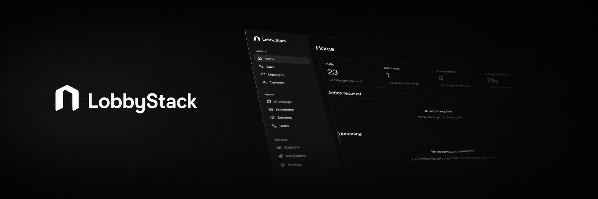
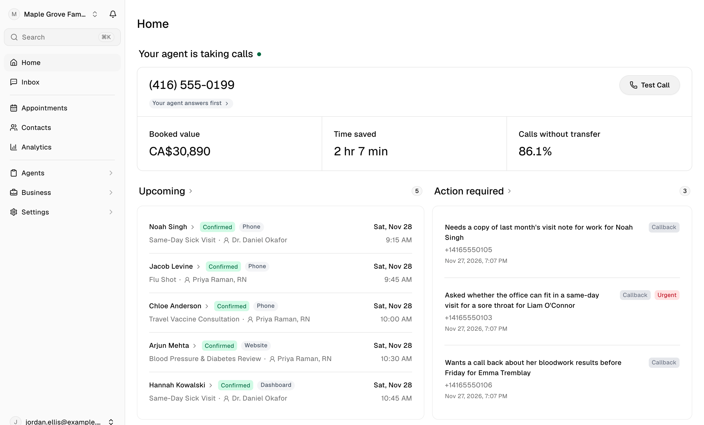
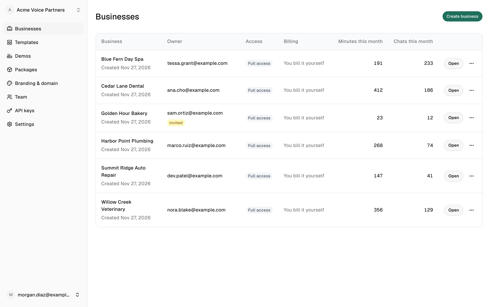

<p align="center">
  
</p>

<div align="center">

# LobbyStack

### The open-source AI receptionist you can self-host, white-label and resell

LobbyStack answers phone calls and website chats for businesses, books appointments, takes messages and transfers callers to a person. Fork it to run your own receptionist service, with the partner console, booking, phone numbers and billing already built.

[Website](https://lobbystack.com) &middot; [Docs](https://docs.lobbystack.com) &middot; [Quickstart](https://docs.lobbystack.com/self-hosting/quickstart) &middot; [Build on LobbyStack](https://docs.lobbystack.com/build/architecture) &middot; [Discord](https://discord.gg/WKX4wCTTpJ)

[](./LICENSE) [](https://www.typescriptlang.org/) [](https://www.postgresql.org/) [](https://docs.lobbystack.com/self-hosting/overview)

[](https://railway.com/deploy/lobbystack)

</div>

<table>
  <tr>
    <td width="50%"></td>
    <td width="50%"></td>
  </tr>
  <tr>
    <td align="center">The dashboard each business sees</td>
    <td align="center">The partner console, under your brand</td>
  </tr>
</table>

## Quickstart

You need Docker and an OpenAI API key.

```bash
curl -fsSL https://raw.githubusercontent.com/lobbystack/lobbystack/main/scripts/quickstart.sh | bash
```

From a clone, run `./scripts/quickstart.sh` instead. Open `http://localhost:3000`, sign up with the code that arrives in Mailpit at `http://localhost:8025`, and talk to your agent in a browser test call.

Or let your coding agent set it up:

- **Claude Code**: `/plugin marketplace add lobbystack/lobbystack`, then `/plugin install lobbystack@lobbystack`
- **Codex**: `codex plugin marketplace add lobbystack/lobbystack`, then `codex plugin add lobbystack@lobbystack`

The [quickstart guide](https://docs.lobbystack.com/self-hosting/quickstart) covers phone numbers, Windows and production.

## Why builders use LobbyStack

- **A finished receptionist.** Calls, booking, messages and transfers work today, so you start from working code.
- **Resell it under your brand.** Each client gets your logo, domain and emails, and pays you through your own Stripe account.
- **Many businesses, one install.** You create, bill and support every client business from the partner console.
- **Self-host it.** Run it with Docker Compose, on Railway or on your own servers, with your own provider accounts.
- **Extend it in TypeScript.** One agent core answers calls and chats, so a tool you add works on every channel.
- **MIT licensed.** You can fork it, change it and sell it.

## Features

### 🏷️ White-label partner console

Partners run their client businesses from one console under their own brand and domain. They set packages and setup fees, bill clients through Stripe Connect, and start new clients from templates or prospect demos.

### ☎️ Phone calls

OpenAI GPT-Live answers inbound calls in 15 languages, on Twilio or Telnyx numbers. It transfers callers to the business or a named employee, and verifies callers before it changes an appointment.

### 📅 Booking

Services, employees, opening hours and closures drive availability. The agent books, reschedules and cancels, syncs with Google Calendar, Cal.com or Calendly, and texts a confirmation and a reminder.

### 📚 Knowledge

The agent answers from text entries, documents and imported website pages. It lists the questions it couldn't answer, so the team can fill the gaps.

### 💬 Website chat and Instagram

The same agent answers a website widget and Instagram direct messages. Incoming texts land in the inbox for the team to answer.

### 🔌 API, CLI and MCP server

A REST API with signed webhooks, the `lobbystack` CLI and an MCP server let your product and your AI assistant run each business. Zapier connects it to other apps.

### 📊 Dashboard

Operators review calls, messages, contacts, appointments and analytics in English, French, Spanish or Serbian.

LobbyStack answers inbound calls only, and it doesn't sync with CRMs.

## Models

Voice runs on OpenAI GPT-Live, which hosts the call audio. LobbyStack doesn't support other voice models yet. The agent behind every tool call and website chat runs on any OpenAI-compatible endpoint, `gpt-6-luna` by default. See [Models the agent runs on](https://docs.lobbystack.com/build/architecture#models-the-agent-runs-on).

## How LobbyStack compares

| | LobbyStack | Closed AI receptionists | Vapi and Retell | Dograh |
| --- | --- | --- | --- | --- |
| Code | MIT, self-hosted or hosted | Hosted, no public code listed | Closed, hosted | BSD 2-Clause, self-hosted or cloud |
| Price | Free to self-host; hosted from $30 a month | $24.95 to $150 a month to start | Vapi: $0.05 a minute plus providers. Retell: $0.07 to $0.31 a minute | Free to self-host |
| Voice models | GPT-Live only | The vendor's | Your choice, GPT-Live included | Your choice |
| Booking and numbers | Built in | Built in | Calendar tools and numbers; you build the rest | Your telephony account; you build the rest |
| Resell under your brand | Partner console | ElevenLabs Reception: no. Frontdesk: from $500 a month | Retell's dashboard can't be rebranded | You build it |

Closed AI receptionists are [ElevenLabs Reception](https://lobbystack.com/blog/elevenlabs-reception-alternative/), [Smith.ai](https://lobbystack.com/blog/smith-ai-alternative/), [Upfirst](https://lobbystack.com/blog/upfirst-alternative/) and [Frontdesk](https://lobbystack.com/blog/my-ai-front-desk-alternative/). Prices come from the vendors' pages, with the dates checked in our comparison posts and in the [Vapi](https://lobbystack.com/blog/vapi-alternative/) and [white-label platform](https://lobbystack.com/blog/white-label-ai-voice-agent-platforms/) posts. We checked [Retell's pricing](https://www.retellai.com/pricing) and [Dograh's README](https://github.com/dograh-hq/dograh) on November 27, 2026.

## MCP server

Connect Claude, ChatGPT, Cursor or any MCP client to a business at `https://app.lobbystack.com/api/mcp`, or `/api/mcp` on your own domain.

```bash
claude mcp add --transport http lobbystack https://app.lobbystack.com/api/mcp
```

The [MCP server guide](https://docs.lobbystack.com/ai/mcp) lists the tools, scopes and limits.

## Architecture

LobbyStack is a TypeScript monorepo on PostgreSQL and Redis:

| Path | What it holds |
| --- | --- |
| `apps/admin` | Next.js dashboard, partner console, HTTP API and MCP server |
| `apps/worker` | Queued jobs and every live call |
| `packages/agent-core` | The agent shared by calls and chats, with its tools |
| `packages/domain` | Business operations such as booking, messages and billing |
| `packages/db` | Schema, migrations and row-level security |
| `packages/providers` | Twilio, Telnyx, calendar, email and embedding adapters |

[Build on LobbyStack](https://docs.lobbystack.com/build/architecture) explains how a call runs, and [Add a capability to the agent](https://docs.lobbystack.com/build/add-a-capability) walks through a new tool. The [ADRs](docs/adr) record the main decisions.

## Run it yourself, or let LobbyStack host it

| | For one business | For your clients, under your brand |
| --- | --- | --- |
| **Run it yourself** | Free under MIT. [Support](https://lobbystack.com/pricing/self-hosted/): $25 or $100 a month per business | Free under MIT. [Support](https://lobbystack.com/white-label/#self-hosted-tiers): $199 or $499 a month |
| **LobbyStack hosts it** | [LobbyStack Cloud](https://lobbystack.com/pricing/): free with 30 minutes a month, then $30 or $100 a month | [White Label](https://lobbystack.com/white-label/): free, then $49, $199 or $499 a month |

Annual billing takes 20% off each paid plan. Self-hosters get community help on [Discord](https://discord.gg/WKX4wCTTpJ) and GitHub, and pay their own OpenAI and carrier bills.

## Contributing

Contributions are welcome. Read [CONTRIBUTING.md](./CONTRIBUTING.md), and use the terms in [GLOSSARY.md](./GLOSSARY.md). Run `pnpm typecheck`, `pnpm lint`, `pnpm test` and `pnpm build` before you open a pull request.

## License

LobbyStack is licensed under the [MIT License](./LICENSE).
