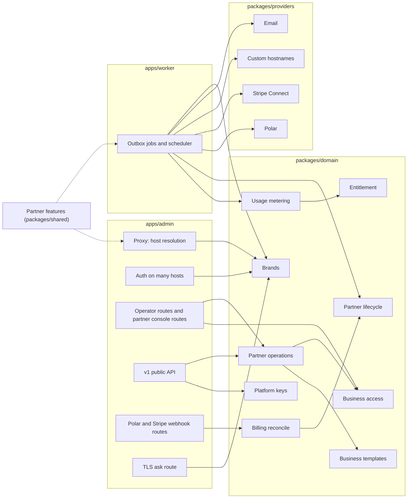

# Understand the partner program's architecture

This page defines the modules the partner program adds or changes, the interface of each, and how requests, usage, and billing flow between them. [How partners resell LobbyStack](../white-label.md) records the product decisions, and [Build the partner program](../white-label-build-plan.md) orders the work. Terms follow [`GLOSSARY.md`](../../GLOSSARY.md).

The design keeps each rule in one module. Callers see a small interface and don't need to know whether a business is direct or belongs to a partner. A caller that reserves voice minutes, for example, never learns that a pool exists.

## Module map



| Module | Lives in | Interface | Hides |
| --- | --- | --- | --- |
| Partner features | `packages/shared` | `partnerFeatures(env)` | Which configuration turns which feature on |
| Brands | `packages/domain` | `resolveHostBrand`, `brandForBusiness` | Host parsing, domain lookup, caching, merging with the host brand |
| Business access | `packages/domain` | `requireBusinessAccess`, `openPartnerBusiness` | Memberships, partner members, audited opens, access levels, brand matching |
| Partner operations | `packages/domain` | Functions that take a `PartnerActor` | Owner-less businesses, invitations, release, delete, branding, team |
| Entitlement | `packages/domain` | `loadEntitlement` | Plans, packages, billed-outside businesses, Stripe and tier state, grace periods |
| Usage metering | `packages/domain` | `reserveUsage`, `extendUsage`, `correctUsage` | Allowances, pools, caps, lock order, sync jobs |
| Partner lifecycle | `packages/domain` | `nextPartnerState`, `applyPartnerTransition` | The 30-day and 90-day steps, and what each step does to businesses and numbers |
| Platform keys | `packages/domain` | `resolvePlatformKey` | Environment and database key sources, groups, what each key may do |
| Business templates | `packages/domain` | `exportBusinessTemplate`, `applyBusinessTemplate` | Reading a setup, comparing, and changing only what differs |
| Billing reconcile | `packages/domain` | `reconcilePartnerTier`, `reconcilePackageSubscription` | Ordering, stale snapshots, and mapping provider states |
| Stripe Connect | `packages/providers` | `StripeConnectProvider` | The Stripe API and the `Stripe-Account` header |
| Custom hostnames | `packages/providers` | `CustomHostnameProvider` | Cloudflare for SaaS, or Caddy with a DNS check |

## Partner features

`partnerFeatures(env)` answers one question for the admin and the worker: what's turned on in this deployment. Both runtimes call it, so they never disagree.

```ts
type PartnerFeatures = {
  enabled: boolean;
  signup: "open" | "invite";
  baseDomain: string | null;            // PARTNER_BASE_DOMAIN
  stripeConnect: boolean;               // keys and webhook secret present
  tierBilling: boolean;                 // every POLAR_PARTNER_<TIER>_<INTERVAL>_PRODUCT_ID present
  customDomains: "cloudflare" | "caddy" | null;
};
```

Every other module reads features through it instead of reading environment variables. A missing piece degrades the way [the decisions](../white-label.md#self-hosted-deployments) describe: no Stripe Connect means every partner business is billed outside LobbyStack, and no tier billing means pools have no limit.

## Brands

Brands decide which brand a request or a business shows.

```ts
type Brand = {
  kind: "host" | "partner";
  partnerId: string | null;
  name: string;
  logoUrl: string | null;
  faviconUrl: string | null;
  color: string | null;
  origin: string;                       // https://acme.receptionistportal.com
  links: { website: string | null; terms: string | null; privacy: string | null; support: string | null };
  email: { fromName: string; fromAddress: string; replyTo: string | null };
};

resolveHostBrand(context, host: string): Promise<Brand | null>
brandForBusiness(context, businessId: string): Promise<Brand>
```

- `resolveHostBrand` returns the host brand for the host's own domain, a partner's brand for a subdomain of the partner base domain or a verified custom domain, and `null` for any other host. The proxy answers `null` with a 404.
- `brandForBusiness` returns the partner's brand for a partner business and the host brand otherwise. The worker calls it when it renders an email, so a brand change applies to emails still in the queue.
- The module caches answers per process, misses included, and clears them when a partner's domain or brand changes through a Redis message.
- The host brand still comes from today's [deployment branding](../branding.md). Texts always use the host brand, so the SMS code keeps calling `deploymentAppName()` and never calls this module.

## Business access

Business access decides whether a person may act in a business, and what they may do there. Every operator route and every RLS check rests on it.

```ts
type BusinessAccess = {
  businessId: string;
  via: "membership" | "partner";
  role: "business_owner" | "business_admin" | "scheduler" | "viewer"; // an admin's through a partner open
  partnerRole: "owner" | "admin" | "member" | null;                    // set through a partner open
  partnerId: string | null;
  accessLevel: "full" | "activity" | null;
  can: (capability: Capability) => boolean;
};
type Capability = "activity" | "setup" | "team" | "billing" | "api_keys" | "mcp";

requireBusinessAccess(tx, input: { userId: string; businessId: string; brand: Brand }): Promise<BusinessAccess>
openPartnerBusiness(context, input: { userId: string; businessId: string; partnerId?: string }): Promise<{ expiresAt: Date }>
```

- `requireBusinessAccess` refuses a business whose brand differs from the request's brand, so a business never shows on another brand's domain. A business of another brand gets the same refusal as one the person isn't on. It replaces `requireBusinessMembership` in `forBusiness`.
- An operator of a partner business gets `activity` at the activity-only level, and `activity`, `setup`, and `team` at full access. They never get `billing`, `api_keys`, or `mcp`.
- Each operator route in the admin needs one capability, from the table in `apps/admin/src/lib/business-capabilities.ts`. `forBusiness` checks the brand and the capability before the handler runs, matching the decoded path, and a route missing from the table needs `setup`.
- The functions behind Polar checkout, the overage cap, operator API keys, webhooks managed from the dashboard, and MCP tokens refuse a partner business too, whatever brand the request came from. MCP's consent screen lists only direct businesses.
- The dashboard remembers, per brand, the business a person last opened on that brand's domains.
- The dashboard hides each page the business doesn't give the person, from the table in `apps/admin/src/lib/dashboard-pages.ts`. The workspace list carries each business's capabilities for it.
- On a partner's domain, a signed-in person with no business there gets a "no businesses" page instead of onboarding, since that domain makes no direct business.
- A partner member reaches a business only after `openPartnerBusiness`. That writes the open with its expiry and an `audit_logs` row in one transaction. In the database, `app.has_partner_access(business_id)` checks the same open, so RLS and the application agree.
- An open lasts 8 hours, and opening again starts the time over. The `partner_business_opens` table keeps one row per person and business, and the audit log gets a `partner.business_opened` row for every open, naming who opened it, when, and until when.
- An open counts only while the business still belongs to the partner that opened it and the person is still on that partner's team. Releasing the business or removing the member ends the access at once.
- `openPartnerBusiness` refuses a business of another partner, a direct business, and anyone off the partner's team. It answers each with a 404, like a business that doesn't exist. The console passes its own partner, so it can't open another partner's business either. The open also makes the business the person's active one on the partner's domains.
- Through an open, a partner member gets full access whatever the business's access level: `activity`, `setup`, and `team`, never `billing`, `api_keys`, or `mcp`. The business's rules see an admin's role, so a partner member never takes an owner's place.
- `app.has_business_membership` answers true for the business's own team or a partner open, so every tenant policy lets the open in. `app.has_team_membership` keeps the old answer for functions that act for the team only.
- Partner members never join the team. `inviteMember` refuses an address on the business's partner's team, and `acceptInvitation` refuses anyone on it, with `partner_member_not_on_team`. `createPartnerBusiness` refuses an owner on the partner's team. `app.is_partner_member_email` answers the address check only for someone on that partner's team, so a business's own operators learn nothing of it.
- `app.list_business_members` lists only the business's own operators, and alert recipients and owner lookups read only memberships. Only the team verifies a phone in the business, because a partner's business forwards calls to its owner's verified phone.
- `requireBusinessMembership` counts a partner open as an admin's role, and `requireTeamMembership` counts only the team. Every runtime role may call `app.partner_access_role`, which answers only for the current person, so the check works on the worker's connection too. A per-business API key acts for its creator only while they're on the team.
- The workspace list includes the businesses a person has open, with `via: "partner"`. Onboarding belongs to the owner, so a partner member who opens a business goes straight to its dashboard.
- The scheduler counts an open in the last 30 days as use, so a business the partner sets up before its owner joins gets its jobs.
- Direct businesses keep today's rules for each role.
- Callers check capabilities, never roles. Adding a role or an access level changes this module only.

## Partner operations

Partner operations are what the console and a partner's platform keys can do. Both entry points call the same functions with a `PartnerActor`, so the console and the API can't drift apart.

```ts
type PartnerActor =
  | { kind: "member"; partnerId: string; userId: string; role: "owner" | "admin" | "member" }
  | { kind: "key"; partnerId: string; platformKeyId: string };
```

- The console's routes live under `/api/partner/*` in the admin and call these functions directly, the way the dashboard's operator routes call domain functions today. The v1 public API's Platform endpoints call the same functions for keys that belong to a partner.
- `createPartnerBusiness` creates a business with no owner, links it to the partner at the access level the partner picks, optionally applies a template, and sends the owner an invitation under the partner's brand. The invitation is never a claim link. A partner's businesses open only on its own domains, so the function refuses until the partner has its subdomain. It never counts toward the cap of 10 businesses per account.
- `listPartnerBusinesses` gives each business's minutes and chats this month, as usage metering counts them. Row-level security shows a partner member none of a business's rows, so `app.list_partner_business_usage` reads the month's counts for someone on the partner's team.
- `releaseBusiness` needs an owner who accepted the invitation. It removes the partner, which leaves that person the owner, and puts the business on the host's Free plan. A trigger on `businesses.partner_id` then deletes the partner's opens of the business and the rows that remember it as someone's business on the partner's domains. Invitations to the business's team from anyone off the team, such as the partner's people, stop working. The audit log records the release as `partner.business_released`.
- `deletePartnerBusiness` deletes the business and every row that belongs to it, its audit log included. It drops the outbox messages that haven't gone out. The worker skips an email whose business no longer exists, through `app.business_exists`, so an email that already left the outbox doesn't reach its people under the host's brand either.
- `deletePartnerBusiness` queues `phoneNumber.releaseDeleted` for each number the business held, and the worker releases each one with the provider. It skips the shared text sender, as a reclaim does. It also queues `privacy.deleteStoredObjects`, and the worker deletes the business's stored files. While a number is still being bought for the business, it refuses with `business_number_in_progress`, since the purchase would finish for a business that's gone.
- `releaseBusiness` and `deletePartnerBusiness` take the team's or the number claims' advisory lock before the business's row lock, the order team changes and claims use.
- Each function checks the actor's role itself. A member can work inside businesses and see their usage, an admin can also manage businesses (create, release and delete them), packages, branding, domains, keys, and the team, and only an owner can manage billing, Stripe, owners, and deleting the partner. An admin can invite, change and remove admins and members, but only an owner can grant the owner role or change or remove an owner.

## Entitlement

Entitlement replaces checks of a plan's slug. It tells every caller what a business may use right now.

```ts
type Entitlement = {
  live: boolean;                        // on a live paid plan or package: dedicated numbers and paid features
  source: "plan" | "package" | "billed_outside" | "unlimited";
  allowance: { voiceSeconds: number | null; chats: number | null; alertSms: number | null; outboundAttempts: number | null };
  overage: { enabled: boolean; currency: string; rates: { voiceMinute: number; chat: number; alertSms: number; outboundAttempt: number }; capMinor: number | null };
  poolPartnerId: string | null;         // usage also draws on this partner's pool
  includedNumbers: number | null;
};

loadEntitlement(tx, businessId: string): Promise<Entitlement>
```

- A direct business gets its plan from the plan catalog, as today. A self-hosted server's businesses get `source: "unlimited"`. A partner business gets its package, or no limit when it's billed outside LobbyStack. It is `live` only while its Stripe subscription is live (unless billed outside) and its partner's tier is live or in its first 30 days after ending. Until packages and tiers arrive, every partner business is billed outside LobbyStack and `live`, with no allowance or overage, and its partner as `poolPartnerId`. Tiers set how many numbers a partner's businesses hold, so until they count them, the cloud's number claims refuse a partner business.
- A direct business that isn't `live` still answers within its Free allowance. A partner business that isn't `live` gets an allowance of 0, so usage metering refuses its calls and chats the way it refuses any business at its limit: calls forward and chat shows its "can't reply" message.
- `hasLiveEntitlement(account)` in `packages/shared` answers `live` from a billing account. The browser and the Polar reconcile use it on account snapshots. For a business's own account, it matches `loadEntitlement(...).live`. It replaces `isPaidSubscription` in TypeScript. The number-claim SQL calls `app.has_live_entitlement(business_id)`, which applies the same rule.
- Direct Starter and Pro plans charge alert texts and outbound attempts against the cap. `rates` carries `alertSms` and `outboundAttempt` for them, beside the minute and chat rates.
- Amounts are in the minor unit of `currency`, so caps work in a partner's currency.

## Usage metering

Usage metering keeps the interface it has today and gains the pool behind it.

```ts
reserveUsage(tx, input: { businessId: string; kind: UsageKind; sourceKey: string; quantity: number }): Promise<Reservation>
extendUsage(tx, input: { businessId: string; sourceKey: string; quantity: number }): Promise<Reservation>
correctUsage(tx, input: { businessId: string; sourceKey: string; quantity: number; final: boolean }): Promise<void>

type Reservation =
  | { allowed: true; granted: number }
  | { allowed: false; reason: "voice_limit_reached" | "chat_limit_reached" | "alert_sms_limit_reached" | "outbound_limit_reached" };
```

- Reserving loads the entitlement, then takes the business lock, then the pool lock when `poolPartnerId` is set, in that order every time. It grants the smaller of what the business has left and what the pool has left.
- The pool lives in `partner_usage_months`. The database reaches it only through SECURITY DEFINER functions, because a business's transaction can't read its partner's other businesses.
- Every reservation stays idempotent per `sourceKey`, as today.
- The module records, on each usage event, the terms in force at the time. A sync job therefore never re-reads a package that changed later.
- Callers in calls, web calls, chat, alert texts, and transfers don't change. Running out still raises `voice_limit_reached`, so calls forward the way commit `c5dd718e` set up.
- A partner's business records each chat even when it has no allowance, since its chats draw on the pool and the console shows them.
- Every operator sees the business's minutes and chats against its allowance on Settings > Usage. `readAllowanceUsageInTransaction` behind `/api/usage` reads them, needs only `activity`, and carries no prices or spend. A business with billing also sees its plan's meters there.

## Partner lifecycle

The lifecycle is a pure function plus one module that applies its result.

```ts
type PartnerState = "active" | "past_due" | "ending" | "paused" | "deleted";
type PartnerEvent = { kind: "tier_paid" | "tier_failed" | "tier_cancelled" | "clock"; at: Date };

nextPartnerState(current: { state: PartnerState; since: Date }, event: PartnerEvent): { state: PartnerState; since: Date }
applyPartnerTransition(context, partnerId: string, next: { state: PartnerState; since: Date }): Promise<void>
```

- `ending` lasts 30 days, during which the partner's businesses answer and the partner can release them. Then `paused`, where calls forward and chat shows its "can't reply" message. The host deletes the businesses 90 days after the tier ended.
- `applyPartnerTransition` fans each change out to the partner's businesses and numbers, and writes it to the audit log.
- `nextPartnerState` does no I/O, so its tests cover every transition without a database.

## Platform keys

`resolvePlatformKey` keeps one interface over two sources.

```ts
resolvePlatformKey(context, token: string): Promise<ResolvedPlatformKey | null>

type ResolvedPlatformKey = {
  platformKeyId: string;
  group: string;
  owner: { kind: "host"; ownerEmail: string; access: "group" | "all" } | { kind: "partner"; partnerId: string };
  scopes: ApiKeyScope[];
};
```

- The module checks `PLATFORM_API_KEYS` first, then the database. It accepts the old `partner` field and access value as aliases ([ADR 0010](../adr/0010-partners-make-their-own-platform-keys.md)).
- A key that belongs to a partner becomes a `PartnerActor` with `kind: "key"`. It can never have `access: "all"`, managed plans, claim links, or Polar checkout, and the database enforces the first with a CHECK.
- The startup webhook cleanup asks this module for the active key ids from both sources.

## Business templates

Templates reuse the `lobbystack onboard` file format.

```ts
exportBusinessTemplate(context, actor: PartnerActor, businessId: string): Promise<BusinessTemplate>
applyBusinessTemplate(port: BusinessSetupPort, template: BusinessTemplate): Promise<ApplyResult>
```

- `BusinessSetupPort` has two adapters. The admin's adapter calls the domain's `*ForApi` functions in-process. The CLI's adapter calls the v1 API over HTTP. One compare-then-change implementation serves both, moved out of the CLI's `onboard.ts`.
- The manifest schema moves to `packages/shared`, without its local file reading.

## Providers

Every outside service sits behind an interface in `packages/providers`. The worker gets them injected, as it gets Polar today, and tests pass fakes.

```ts
interface StripeConnectProvider {
  createOnboardingLink(input: { accountId: string | null; returnUrl: string }): Promise<{ accountId: string; url: string }>;
  upsertPackagePrice(accountId: string, pkg: PackageTerms): Promise<{ productId: string; priceId: string }>;
  createCheckout(accountId: string, input: CheckoutInput): Promise<{ url: string }>;
  createPortal(accountId: string, customerId: string, returnUrl: string): Promise<{ url: string }>;
  reportOverage(accountId: string, input: { identifier: string; customerId: string; meter: "voice" | "chat"; quantity: number }): Promise<void>;
  verifyWebhook(body: string, signature: string): StripeEvent;
}

interface CustomHostnameProvider {
  create(hostname: string): Promise<{ id: string }>;
  status(id: string): Promise<{ state: "pending" | "active" | "failed"; records: DnsRecord[]; errors: string[] }>;
  remove(id: string): Promise<void>;
}
```

- `CustomHostnameProvider` has two production adapters. Cloudflare for SaaS serves the cloud. The Caddy adapter serves self-hosted deployments: it checks that the domain's DNS points at the deployment, and Caddy then asks `/api/tls/ask` before issuing a certificate.
- The Polar provider keeps its interface. Tier billing uses `partner:<id>` as the customer's external id.
- The email provider already takes a sender and a Reply-To per message. The worker fills them from `brandForBusiness`.

## Data flows

### A request on a partner's domain

1. Cloudflare for SaaS, or Caddy when self-hosted, terminates TLS and forwards the request to the admin.
2. The proxy calls `resolveHostBrand` with the Host header. It answers 404 when the result is `null`. Otherwise it strips any brand header the client sent and adds the resolved partner's id.
3. Better Auth trusts the request's origin only when the proxy resolved it. Partner brands have no Google sign-in.
4. Pages and routes read the brand from the header through one admin helper, and render with it.
5. An operator route calls `requireBusinessAccess` with that brand, then runs inside `withBusinessTransaction`. RLS allows the rows through a membership or an audited partner open.

### Usage from a phone call

1. The admin's live webhook calls `reserveUsage` for voice before it answers.
2. Usage metering loads the entitlement, locks the business and then the pool, and grants a slice. When it can't, it returns `voice_limit_reached`, the webhook answers 503, and Twilio fails the call over so it forwards.
3. The worker extends the reservation during the call. At the end, `correctUsage` writes the final quantity.
4. The final event queues `billing.syncUsage`. The worker reports the business's overage to the partner's Stripe through `reportOverage`, and the pool's overage to Polar under the partner's customer.
5. Crossing 80% or 100% of an allowance or a pool queues an alert email under the right brand.

### Tier and package billing

1. Polar's webhook and Stripe's Connect webhook store each event in `provider_events` and queue a reconcile.
2. `reconcilePartnerTier` maps Polar's subscription to a `PartnerEvent` and runs it through `nextPartnerState` and `applyPartnerTransition`.
3. `reconcilePackageSubscription` updates the business's billing account. `loadEntitlement` reads it on the next reservation.
4. An hourly scheduler job sends `clock` events, which move partners from `ending` to `paused` and then to deletion.

### A custom domain

1. A partner adds a domain in the console. The domain module stores it as pending and queues `partnerDomain.provision`.
2. The worker calls `CustomHostnameProvider.create`, then a scheduler job polls `status` until the domain is active or failed. The console shows the DNS records to add.
3. When the domain turns active, the module marks it verified and publishes a Redis message, and every admin process clears that host from the brand cache.
4. From then on, `resolveHostBrand` returns the partner's brand for that host, and `/api/tls/ask` approves it.

### A new business from the console

1. The console calls `createPartnerBusiness`, which creates the owner-less business, applies the chosen template, and queues the invitation email.
2. The owner opens the link on the partner's domain and pays at the Stripe checkout on the partner's account, or signs in when the business is billed outside LobbyStack.
3. Stripe's webhook reconciles the subscription, and the business's entitlement goes live.
4. The owner lands in the business. Their onboarding skips creating it, the number step and attribution, and ends once they verify their phone. At activity only, the phone is their only step.

## Where each module is tested

The partner program uses three test seams, from highest to lowest:

- **Domain functions against PostgreSQL**, with the real runtime roles and RLS: business access and audited opens, brands, partner operations, entitlement, usage metering and pools, platform keys, templates, number claims, and lifecycle transitions. The existing `*.integration.test.ts` files are prior art.
- **The admin's request pipeline**: host resolution in the proxy, sign-in and CSRF on partner domains, branded pages, refused hosts, and the TLS ask route. The existing route handler and proxy tests are prior art.
- **Provider interfaces with fakes**: the worker's billing sync, Polar and Stripe webhooks and reconcile, and custom hostname provisioning. The worker's `handleJob` tests, which pass a fake Polar, are prior art.

`nextPartnerState` and `partnerFeatures` have no I/O, so their tests call them directly. Tests assert what a caller can observe through each interface, not tables or internal calls.
