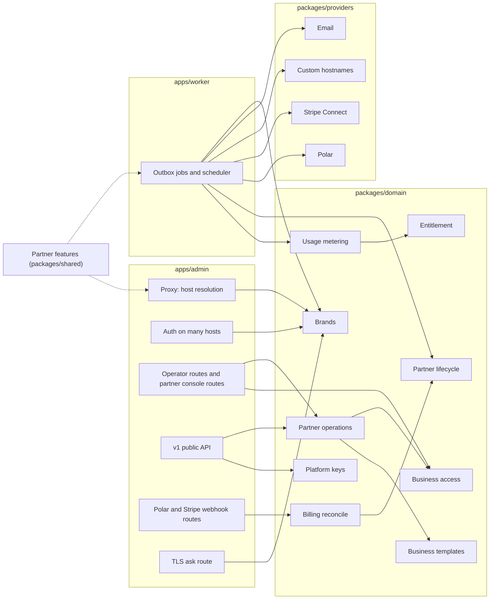

# Understand the partner program's architecture

This page defines the modules the partner program adds or changes, the interface of each, and how requests, usage, and billing flow between them. [How partners resell LobbyStack](../white-label.md) records the product decisions, and [Build the partner program](../white-label-build-plan.md) orders the work. Terms follow [`GLOSSARY.md`](../../GLOSSARY.md).

The design keeps each rule in one module. Callers see a small interface and don't need to know whether a business is direct or belongs to a partner. A caller that reserves voice minutes, for example, never learns that a pool exists.

## Module map



| Module | Lives in | Interface | Hides |
| --- | --- | --- | --- |
| Partner features | `packages/shared` | `partnerFeatures(env)` | Which configuration turns which feature on |
| Brands | `packages/domain` | `resolveHostBrand`, `brandForBusiness` | Host parsing, domain lookup, caching, merging with the host brand |
| Business access | `packages/domain` | `requireBusinessAccess`, `openPartnerBusiness` | Memberships, partner members, audited opens, access levels, brand matching |
| Partner operations | `packages/domain` | Functions that take a `PartnerActor` | Owner-less businesses, invitations, release, delete, branding, team |
| Entitlement | `packages/domain` | `loadEntitlement` | Plans, packages, billed-outside businesses, Stripe and tier state, grace periods |
| Usage metering | `packages/domain` | `reserveUsage`, `extendUsage`, `correctUsage` | Allowances, pools, caps, lock order, sync jobs |
| Partner lifecycle | `packages/domain` | `nextPartnerState`, `applyPartnerTransition` | The 30-day and 90-day steps, and what each step does to businesses and numbers |
| Platform keys | `packages/domain` | `resolvePlatformKey` | Environment and database key sources, groups, what each key may do |
| Business templates | `packages/shared` and `packages/domain` | `applyBusinessTemplate`, `exportBusinessTemplate`, `saveBusinessTemplate` | Reading a setup, comparing, changing only what differs, and the copies of a template's documents |
| Prospect demos | `packages/domain` | `createPartnerDemo`, `listPartnerDemos`, `claimProspectDemo` | The host's demos and a partner's, the brand a demo names and opens on, and what claiming one keeps |
| Billing reconcile | `packages/domain` | `reconcilePartnerTier`, `reconcilePackageSubscription` | Ordering, stale snapshots, and mapping provider states |
| Stripe Connect | `packages/providers` | `StripeConnectProvider` | The Stripe API and the `Stripe-Account` header |
| Custom hostnames | `packages/providers` | `CustomHostnameProvider` | Cloudflare for SaaS, or Caddy with a DNS check |

## Partner features

`partnerFeatures(env)` answers one question for the admin and the worker: what's turned on in this deployment. Both runtimes call it, so they never disagree.

```ts
type PartnerFeatures = {
  enabled: boolean;
  signup: "open" | "invite";
  baseDomain: string | null;            // PARTNER_BASE_DOMAIN
  stripeConnect: boolean;               // keys and webhook secret present
  tierBilling: boolean;                 // every POLAR_PARTNER_<TIER>_<INTERVAL>_PRODUCT_ID present, each its own product
  customDomains: "cloudflare" | "caddy" | null;
};
```

Every other module reads features through it instead of reading environment variables. A missing piece degrades the way [the decisions](../white-label.md#self-hosted-deployments) describe: no Stripe Connect means every partner business is billed outside LobbyStack, and no tier billing means pools have no limit.

## Brands

Brands decide which brand a request or a business shows.

```ts
type Brand = {
  kind: "host" | "partner";
  partnerId: string | null;
  name: string;
  logoUrl: string | null;
  faviconUrl: string | null;
  color: string | null;
  origin: string;                       // https://acme.receptionistportal.com
  links: { website: string | null; terms: string | null; privacy: string | null; support: string | null };
  email: { fromName: string; fromAddress: string; replyTo: string | null };
};

resolveHostBrand(context, host: string): Promise<Brand | null>
brandForBusiness(context, businessId: string): Promise<Brand>
```

- `resolveHostBrand` returns the host brand for the host's own domain, a partner's brand for a subdomain of the partner base domain or a verified custom domain, and `null` for any other host. The proxy answers `null` with a 404.
- `brandForBusiness` returns the partner's brand for a partner business and the host brand otherwise. The worker calls it when it renders an email, so a brand change applies to emails still in the queue.
- The module caches answers per process, misses included, and clears them when a partner's domain or brand changes through a Redis message.
- The host brand still comes from today's [deployment branding](../branding.md). Texts always use the host brand, so the SMS code keeps calling `deploymentAppName()` and never calls this module.

## Business access

Business access decides whether a person may act in a business, and what they may do there. Every operator route and every RLS check rests on it.

```ts
type BusinessAccess = {
  businessId: string;
  via: "membership" | "partner";
  role: "business_owner" | "business_admin" | "scheduler" | "viewer"; // an admin's through a partner open
  partnerRole: "owner" | "admin" | "member" | null;                    // set through a partner open
  partnerId: string | null;
  accessLevel: "full" | "activity" | null;
  can: (capability: Capability) => boolean;
};
type Capability = "activity" | "setup" | "team" | "billing" | "api_keys" | "mcp";

requireBusinessAccess(tx, input: { userId: string; businessId: string; brand: Brand }): Promise<BusinessAccess>
openPartnerBusiness(context, input: { userId: string; businessId: string; partnerId?: string }): Promise<{ expiresAt: Date }>
```

- `requireBusinessAccess` refuses a business whose brand differs from the request's brand, so a business never shows on another brand's domain. A business of another brand gets the same refusal as one the person isn't on. It replaces `requireBusinessMembership` in `forBusiness`.
- An operator of a partner business gets `activity` at the activity-only level, and `activity`, `setup`, and `team` at full access. They never get `billing`, `api_keys`, or `mcp`.
- Each operator route in the admin needs one capability, from the table in `apps/admin/src/lib/business-capabilities.ts`. `forBusiness` checks the brand and the capability before the handler runs, matching the decoded path, and a route missing from the table needs `setup`.
- The functions behind Polar checkout, managed plans, the overage cap, operator API keys, webhooks managed from the dashboard, and MCP tokens refuse a partner business too, whatever brand the request came from. MCP's consent screen lists only direct businesses.
- The dashboard remembers, per brand, the business a person last opened on that brand's domains.
- The dashboard hides each page the business doesn't give the person, from the table in `apps/admin/src/lib/dashboard-pages.ts`. The workspace list carries each business's capabilities for it.
- On a partner's domain, a signed-in person with no business there gets a "no businesses" page instead of onboarding, since that domain makes no direct business.
- A partner member reaches a business only after `openPartnerBusiness`. That writes the open with its expiry and an `audit_logs` row in one transaction. In the database, `app.has_partner_access(business_id)` checks the same open, so RLS and the application agree.
- An open lasts 8 hours, and opening again starts the time over. The `partner_business_opens` table keeps one row per person and business, and the audit log gets a `partner.business_opened` row for every open, naming who opened it, when, and until when.
- An open counts only while the business still belongs to the partner that opened it and the person is still on that partner's team. Releasing the business or removing the member ends the access at once.
- `openPartnerBusiness` refuses a business of another partner, a direct business, and anyone off the partner's team. It answers each with a 404, like a business that doesn't exist. The console passes its own partner, so it can't open another partner's business either. The open also makes the business the person's active one on the partner's domains.
- Through an open, a partner member gets full access whatever the business's access level: `activity`, `setup`, and `team`, never `billing`, `api_keys`, or `mcp`. The business's rules see an admin's role, so a partner member never takes an owner's place.
- A partner open doesn't reach the business's Billing tab, where its own owners and admins pay the partner: `getPackageBilling`, `startPackageCheckout` and `openPackagePortal` check `requireTeamMembership`.
- `app.has_business_membership` answers true for the business's own team or a partner open, so every tenant policy lets the open in. `app.has_team_membership` keeps the old answer for functions that act for the team only.
- Partner members never join the team. `inviteMember` refuses an address on the business's partner's team, and `acceptInvitation` refuses anyone on it, with `partner_member_not_on_team`. `createPartnerBusiness` refuses an owner on the partner's team. `app.is_partner_member_email` answers the address check only for someone on that partner's team, so a business's own operators learn nothing of it.
- `app.list_business_members` lists only the business's own operators, and alert recipients and owner lookups read only memberships. Only the team verifies a phone in the business, because a partner's business forwards calls to its owner's verified phone.
- `requireBusinessMembership` counts a partner open as an admin's role, and `requireTeamMembership` counts only the team. Every runtime role may call `app.partner_access_role`, which answers only for the current person, so the check works on the worker's connection too. A per-business API key acts for its creator only while they're on the team.
- The workspace list includes the businesses a person has open, with `via: "partner"`. Onboarding belongs to the owner, so a partner member who opens a business goes straight to its dashboard.
- The scheduler counts an open in the last 30 days as use, so a business the partner sets up before its owner joins gets its jobs.
- Direct businesses keep today's rules for each role.
- Callers check capabilities, never roles. Adding a role or an access level changes this module only.

## Partner operations

Partner operations are what the console and a partner's platform keys can do. Both entry points call the same functions with a `PartnerActor`, so the console and the API can't drift apart.

```ts
type PartnerActor =
  | { kind: "member"; partnerId: string; userId: string; role: "owner" | "admin" | "member" }
  | { kind: "key"; partnerId: string; platformKeyId: string };
```

- The console's routes live under `/api/partner/*` in the admin and call these functions directly, the way the dashboard's operator routes call domain functions today. The v1 public API's Platform endpoints call the same functions for keys that belong to a partner.
- `createPartnerBusiness` creates a business with no owner, links it to the partner at the access level the partner picks, optionally applies a template, and sends the owner an invitation under the partner's brand. The invitation is never a claim link. A partner's businesses open only on its own domains, so the function refuses until the partner has its subdomain. It never counts toward the cap of 10 businesses per account.
- `listPartnerBusinesses` gives each business's minutes and chats this month, as usage metering counts them. Row-level security shows a partner member none of a business's rows, so `app.list_partner_business_usage` reads the month's counts for someone on the partner's team. It leaves out the prospect demos nobody has claimed, which the Demos page lists instead.
- `releaseBusiness` needs an owner who accepted the invitation. It removes the partner, which leaves that person the owner, and puts the business on the host's Free plan. A trigger on `businesses.partner_id` then deletes the partner's opens of the business and the rows that remember it as someone's business on the partner's domains. Invitations to the business's team from anyone off the team, such as the partner's people, stop working. The audit log records the release as `partner.business_released`.
- `releaseBusiness` also drops the business's package, by the rule `setPartnerBusinessBilling` follows. While the subscription is live and the deployment would hear it end, it refuses with `subscription_active` until the partner cancels the subscription in Stripe. It closes any open checkout.
- `deletePartnerBusiness` deletes the business and every row that belongs to it, its audit log included. It drops the outbox messages that haven't gone out. The worker skips an email whose business no longer exists, through `app.business_exists`, so an email that already left the outbox doesn't reach its people under the host's brand either.
- `deletePartnerBusiness` queues `phoneNumber.releaseDeleted` for each number the business held, and the worker releases each one with the provider. It skips the shared text sender, as a reclaim does. It also queues `privacy.deleteStoredObjects`, and the worker deletes the business's stored files. While a number is still being bought for the business, it refuses with `business_number_in_progress`, since the purchase would finish for a business that's gone.
- `deletePartnerBusiness` refuses the same way while the business pays for a package through Stripe, and closes its open checkout, so its owner can't keep paying for a business that's gone.
- `releaseBusiness` and `deletePartnerBusiness` take the team's or the number claims' advisory lock, then the billing account's, and only then the business's row lock. Team changes, claims and the Connect webhook lock in that order too.
- The Stripe page's functions (`getPartnerStripeConnection`, `startPartnerStripeOnboarding`) let only owners connect Stripe. The Packages page's (`listPartnerPackages`, `createPartnerPackage`, `renamePartnerPackage`, `archivePartnerPackage`) let owners and admins sell packages in the connected account's currency. Members see neither, and the database keeps each package on its partner's own connected account.
- `createPartnerBusiness` takes the package the business is sold, or none to bill it outside LobbyStack, and `setPartnerBusinessBilling` changes it until the business pays. Once the deployment can't hear that subscription end, after the partner disconnects its account or without Stripe Connect, the partner can change it again, and the change drops the subscription. Owners and admins see each business's package and payment status on the Businesses page. Members never see a business's billing, and the database sells a business only its own partner's packages.
- Each function checks the actor's role itself. A member can work inside businesses and see their usage, an admin can also manage businesses (create, release and delete them), packages, templates, branding, domains, keys, and the team, and only an owner can manage billing, Stripe, owners, and deleting the partner. An admin can invite, change and remove admins and members, but only an owner can grant the owner role or change or remove an owner.

## Entitlement

Entitlement replaces checks of a plan's slug. It tells every caller what a business may use right now.

```ts
type Entitlement = {
  live: boolean;                        // on a live paid plan or package: dedicated numbers and paid features
  source: "plan" | "package" | "billed_outside" | "unlimited";
  allowance: { voiceSeconds: number | null; chats: number | null; alertSms: number | null; outboundAttempts: number | null };
  overage: { enabled: boolean; currency: string; rates: { voiceMinute: number; chat: number; alertSms: number; outboundAttempt: number }; capMinor: number | null };
  poolPartnerId: string | null;         // usage also draws on this partner's pool
  includedNumbers: number | null;
};

loadEntitlement(tx, businessId: string): Promise<Entitlement>
```

- A direct business gets its plan from the plan catalog, as today. A self-hosted server's businesses get `source: "unlimited"`. A partner business gets its package, or no limit when it's billed outside LobbyStack. It is `live` only while its Stripe subscription is live (unless billed outside) and its partner's tier is live or in its first 30 days after ending. A partner business with no package is billed outside LobbyStack, and so is every partner business on a deployment without Stripe Connect. Until its partner's tier counts toward `live`, a business on a package is `live` while its Stripe subscription is `active`, `trialing` or `past_due`, with the package's minutes and chats and no overage, and every partner business has its partner as `poolPartnerId`. Its partner's tier sets how many numbers the partner's businesses hold between them, as [Phone numbers](#phone-numbers) describes.
- A direct business that isn't `live` still answers within its Free allowance. A partner business that isn't `live` gets an allowance of 0, so usage metering refuses its calls and chats the way it refuses any business at its limit: calls forward and chat shows its "can't reply" message.
- `hasLiveEntitlement(account)` in `packages/shared` answers `live` from a billing account. The browser and the Polar reconcile use it on account snapshots. For a direct business's own account, it matches `loadEntitlement(...).live`. A partner business on a package gets `live` from `hasLivePackageSubscription(state)` on its Stripe subscription's state instead, and one billed outside LobbyStack is always live. It replaces `isPaidSubscription` in TypeScript. The number-claim SQL calls `app.has_live_entitlement(business_id)`, which applies the same rule, packages included. SQL can't read the deployment's configuration, so on a deployment without Stripe Connect it still asks a business on a package for its subscription. Only the number claims ask it, so on the cloud such a business gets no new number until its subscription is live again.
- Direct Starter and Pro plans charge alert texts and outbound attempts against the cap. `rates` carries `alertSms` and `outboundAttempt` for them, beside the minute and chat rates.
- Amounts are in the minor unit of `currency`, so caps work in a partner's currency.

## Usage metering

Usage metering keeps the interface it has today and gains the pool behind it.

```ts
reserveUsage(tx, input: { businessId: string; kind: UsageKind; sourceKey: string; quantity: number }): Promise<Reservation>
extendUsage(tx, input: { businessId: string; sourceKey: string; quantity: number }): Promise<Reservation>
correctUsage(tx, input: { businessId: string; sourceKey: string; quantity: number; final: boolean }): Promise<void>

type Reservation =
  | { allowed: true; granted: number }
  | { allowed: false; reason: "voice_limit_reached" | "chat_limit_reached" | "alert_sms_limit_reached" | "outbound_limit_reached" };
```

- Reserving loads the entitlement, then takes the business lock, then the pool lock when `poolPartnerId` is set, in that order every time. It grants the smaller of what the business has left and what the pool has left.
- The pool lives in `partner_usage_months`. The database reaches it only through SECURITY DEFINER functions, because a business's transaction can't read its partner's other businesses.
- Every reservation stays idempotent per `sourceKey`, as today.
- The module records, on each usage event, the terms in force at the time. A sync job therefore never re-reads a package that changed later.
- Callers in calls, web calls, chat, alert texts, and transfers don't change. Running out still raises `voice_limit_reached`, so calls forward the way commit `c5dd718e` set up.
- A partner's business records each chat even when it has no allowance, since its chats draw on the pool and the console shows them.
- Every operator sees the business's minutes and chats against its allowance on Settings > Usage. `readAllowanceUsageInTransaction` behind `/api/usage` reads them, needs only `activity`, and carries no prices or spend. A business with billing also sees its plan's meters there.

## Phone numbers

A partner's tier sets how many phone numbers its businesses hold between them. Tier billing, as `partnerFeatures(...).tierBilling` decides, sets who counts them and who pays for the extra ones:

| Deployment | Tier billing on | Tier billing off |
|---|---|---|
| Cloud | The claims count the partner's numbers against its tier, and the worker charges the partner for each one past the included ones. | The claims refuse every new number with `partner_numbers_unavailable`, since nobody would pay for it. A replacement for a number the business holds still goes through. |
| Self-hosted | Same as the cloud. | No tier limit and no charges. The claim quotas still apply. |

- Only the environment knows whether the deployment bills tiers, so the worker records it in `partner_tier_billing` when it starts and on each run of `billing.chargePartnerNumbers`. Until the worker first records it after migration 0147, the deployment bills no tiers, so the cloud refuses partners' new numbers.
- Every claim, from onboarding, a replacement, a trial or the API, writes a row in `onboarding_number_claim_events`. A trigger on that table takes the partner's lock after the business's, so two of the partner's businesses claim in turn.
- The partner holds its businesses' active numbers that aren't scheduled for release, plus the new numbers that claims are buying now.
- While the deployment bills tiers, a claim for a new number past the tier's included numbers needs a paid tier. Free includes none, so a business of a Free partner gets no dedicated number until the per-partner trial arrives. A replacement adds no number, so the count skips it.
- A partner's business never gets the host's free trial number. One that isn't `live`, such as a business whose package isn't paid, gets `partner_numbers_unavailable` from the number search and the claims on the cloud.
- The claim quotas apply on every deployment:
  - Each business makes at most 3 claims an hour.
  - With tier billing, the partner's businesses share quotas sized from the tier in force. They buy up to the larger of 2 and the tier's included numbers a day, and the larger of 5 and twice those in 30 days. Scale, with 25 included numbers, buys up to 25 a day and 50 in 30 days.
  - Without tier billing, the partner's businesses share 2 numbers a day and 5 in 30 days.
- The shared quotas count the numbers bought in their window and the claims still buying one. Claiming from many new businesses at once doesn't get a partner past them.
- `numberEligibilityInTransaction` reads the same count through `app.partner_number_standing` and applies the same rules through `newPartnerNumberRefusal`, so the number search refuses before it asks the carrier. A partner's business has no billing capability, so the dashboard's phone settings read `partnerNumberAvailabilityInTransaction` from `GET /api/phone-numbers` instead of the business's plan. The console's Billing page shows the count to the partner's owners.
- Before it buys a number that counts against a partner's tier, the worker reads what Twilio charges the host for it each month, and stores that in `partner_number_charges`.
- The hourly `billing.chargePartnerNumbers` job settles each month of each number. The partner's oldest numbers are the included ones. Each month of a number past them, on a paid tier, goes to Polar as a `billing.partner_extra_numbers` event under the partner's customer.
- A number scheduled for release settles its months uncharged, so a cancelled release charges no month late. A released number, or one whose business left the partner, settles no more months.
- When Polar refuses one of a partner's charges, that partner's charged months wait for the next run. Every other month still settles, and the job then fails with the count of charges that wait.
- The Billing page shows each tier's price, pool and included numbers from `partnerTierCatalog` on every deployment, and the reconcile records the same pool and included numbers. A self-hoster's Polar products must charge the catalog's prices.

## Partner lifecycle

The lifecycle is a pure function plus one module that applies its result.

```ts
type PartnerState = "active" | "past_due" | "ending" | "paused" | "deleted";
type PartnerEvent = { kind: "tier_paid" | "tier_failed" | "tier_cancelled" | "clock"; at: Date };

nextPartnerState(current: { state: PartnerState; since: Date }, event: PartnerEvent): { state: PartnerState; since: Date }
applyPartnerTransition(context, partnerId: string, next: { state: PartnerState; since: Date }): Promise<void>
```

- `ending` lasts 30 days, during which the partner's businesses answer and the partner can release them. Then `paused`, where calls forward and chat shows its "can't reply" message. The host deletes the businesses 90 days after the tier ended.
- `applyPartnerTransition` fans each change out to the partner's businesses and numbers, and writes it to the audit log.
- `nextPartnerState` does no I/O, so its tests cover every transition without a database.

## Platform keys

`resolvePlatformKey` keeps one interface over two sources.

```ts
resolvePlatformKey(context, token: string): Promise<ResolvedPlatformKey | null>

type ResolvedPlatformKey = { platformKeyId: string; prefix: string; name: string; group: string; scopes: ApiKeyScope[]; createdAt: string } & (
  | { ownerEmail: string; access: "group" | "all" }       // the host's, from PLATFORM_API_KEYS
  | { partnerId: string; access: "group" }                 // a partner's, from partner_platform_keys
);
```

- The module checks `PLATFORM_API_KEYS` first, then `partner_platform_keys`, which keeps only each key's SHA-256. It accepts the old `partner` field and access value as aliases ([ADR 0010](../adr/0010-partners-make-their-own-platform-keys.md)).
- A partner's key uses the partner as its group. Each business of the partner joins that group in `platform_key_businesses` when it's made, whether the console or a key made it, and leaves it when it leaves the partner. The database refuses to link any other business to a partner's group. A partner's key therefore reaches and lists businesses through its group, as a host's key does, and also checks that the business is still its partner's.
- A partner's key acts as the partner. Its v1 caller carries the partner instead of an account, and partner operations see it as a `PartnerActor` with `kind: "key"`. It can never have `access: "all"`, managed plans, claim links, or Polar checkout, and the database enforces the first with a CHECK.
- `createPartnerPlatformKey`, `listPartnerPlatformKeys`, and `revokePartnerPlatformKey` are partner operations for owners and admins. The console's API keys page calls them through `/api/partner/platform-keys`.
- Revoking a key, in the same transaction, turns off the webhook endpoints it set up and revokes the team invitations it sent that nobody accepted. The owner invitations it sent as it created businesses stay, since the console can't send another. A request with a partner's key holds a share lock on the key's row while it creates a webhook endpoint, an invitation or a business, so a revoke waits for it and catches what it wrote.
- The startup webhook cleanup passes the ids in `PLATFORM_API_KEYS`. In the same statement, the database keeps the endpoints of a partner's key while the key isn't revoked and still reaches the business.
- `POST /businesses` with a partner's key calls `createPartnerBusiness` with the key as the actor, on the app role, since only it can act as the system. The request names the owner in `owner_email` and the access level in `access_level`. The Idempotency-Key decides the business's id, as it does for a host's key.
- A partner's key invites people as the partner: the owner when it creates a business, and staff through `POST /team/invitations`. Those invitations carry `invited_by_platform_key_id` and no person. A claim link always names the account that sent it. `POST /users` sends its email under the partner's brand.
- A partner can make as many keys as it likes, so the limits on what its keys send count against the partner: 30 new businesses an hour, 20 team invitations an hour, and the daily `POST /users` invitations.
- Operations that act as a person stay closed to a partner's key: number search and claims, and reading or changing alert preferences.
- Links in API responses point at the business's own dashboard: the widget's script tag and the calendar connect link use the partner's origin for a partner's business, and `APP_BASE_URL` for a direct one. The connect route keeps a signed-out visitor's sign-in and its errors on the domain it was opened on. Google's callback still returns to the host's domain, and moves to the partner's with the custom domains work.

## Business templates

Templates reuse the `lobbystack onboard` file format. A template is a manifest without the parts that belong to one business.

```ts
// packages/shared
applyBusinessTemplate(port: BusinessSetupPort, template: BusinessTemplate, options?: { plan?: boolean }): Promise<ApplyResult>

// packages/domain
exportBusinessTemplate(context, actor: PartnerActor, businessId: string): Promise<BusinessTemplate>
saveBusinessTemplate(context, actor: PartnerActor, input: { businessId: string; name: string }, dependencies: { storage }): Promise<PartnerTemplate>
listBusinessTemplates(context, actor: PartnerActor): Promise<PartnerTemplate[]>
deleteBusinessTemplate(context, actor: PartnerActor, input: { templateId: string }): Promise<void>
```

- `packages/shared/src/businessSetup.ts` holds the manifest schema, `businessTemplateSchema`, the `BusinessSetupPort` interface, and the compare-then-change steps that `lobbystack onboard` used to keep in `onboard.ts`: business details, receptionist, services, rules, websites, FAQs and texts. The schema has no local file reading; `packages/cli/src/manifest.ts` reads the file and checks it against the schema.
- The port has two adapters. The CLI's, in `packages/cli/src/setupPort.ts`, calls the v1 API over HTTP. The domain's `inProcessSetupPort` calls the same `*ForApi` operations in-process, as a `PartnerMemberCaller`, so the business's audit log names the partner member. That caller acts for the partner, as a partner's key does, so the operations refuse it a Polar checkout, a claim link and a managed plan. The CLI calls the steps one by one, because it puts its plan, documents, number and claim link between them, and its behavior didn't change. The console calls `applyBusinessTemplate`, which runs the steps in onboard's order.
- A template leaves out the business's id and slug, plan, phone number, transfer number, owner, onboarding, access level and the staff who take each service. It also leaves out entries, websites and documents the business turned off, the greeting written for the business's name, and a summary no person wrote. A setup the format can't hold, such as a rule longer than calls read, is refused with `template_invalid`.
- The business's own website describes that business only, so a template leaves out `website_url` and every website source on the same host, ignoring a leading `www.`. A website source on another host stays. A template also leaves out the booking policy and voice and text instructions a prospect demo writes for itself while they're unchanged.
- Saving or exporting a template reads the business without an open, so the business's audit log gets a `partner.business_setup_exported` row in the same transaction as the read. It names the partner member and their role, and the template's id and name when the read was for a save.
- `business_templates` keeps each template under its partner, and `business_template_files` keeps a stored copy of each document, so a template outlives the business it came from. Anyone on the partner's team reads them, and owners and admins save and delete them. Row-level security checks `app.partner_role` on every statement, and a template never changes once saved. Deleting a template queues `privacy.deleteStoredObjects` for its copies.
- `createPartnerBusiness` takes an optional `templateId` and the worker's context, because the `*ForApi` operations run as `lobbystack_worker`. It applies the template after it creates the business and before it invites the owner. The business keeps the name and time zone the console sent. If the template can't be applied, the function deletes the business and answers `template_failed`, so the owner never hears of a business that isn't set up. It also deletes the business when the invitation fails after the template was applied. This cleanup skips the role check, since nobody else knows of the business, and a cleanup that fails is logged. That business then shows on the Businesses page with no owner, where an owner or admin can delete it.
- Only someone on the partner's team reads its templates, so `createPartnerBusiness` refuses a template from a platform key, and `POST /businesses` takes none. The console can send a package and a template together. The function sets the package when it creates the business, and the cleanup after a failed template deletes the package with the business.
- Applying doesn't wait for a website's sample read, so a template with `read_full_site` leaves the full read for the business's Knowledge page.

## Prospect demos

A partner's team makes prospect demos from the console under the partner's brand. A partner's demo is one of its businesses from the start, so it follows the rules of the host's demos and of the partner's businesses at once.

```ts
createPartnerDemo(context, actor: PartnerActor, input: { name: string; websiteUrl: string; accessLevel?: PartnerAccessLevel; greeting?: string; suggestedPrompts?: string[] }): Promise<{ demoId: string; businessId: string; token: string; url: string }>
listPartnerDemos(context, actor: PartnerActor): Promise<PartnerDemo[]>
publishPartnerDemo(context, actor: PartnerActor, input: { demoId: string; token: string }): Promise<{ status: "active"; expiresAt: Date }>
rotatePartnerDemoToken(context, actor: PartnerActor, input: { demoId: string }): Promise<{ token: string; url: string }>
revokePartnerDemo(context, actor: PartnerActor, input: { demoId: string }): Promise<void>
deletePartnerDemo(context, actor: PartnerActor, input: { demoId: string }): Promise<void>
claimProspectDemo(context, input: { userId: string; token: string; brand: BrandScope }): Promise<{ businessId: string; status: "claimed" | "already_claimed" }>
```

- Anyone on the partner's team makes, publishes, rotates and turns off the partner's demos: owners, admins and members alike. Only owners and admins pick a demo's access level and delete a demo, as they do for any of the partner's businesses. The host's demo operator, whom `PROSPECT_DEMO_OPERATOR_EMAIL` names, keeps managing the host's demos. `prospect_demos.partner_id` records the partner whose team made a demo, and the host operator's resolvers leave those demos out.
- The demo's business belongs to the partner and has no owner. It gets full access, unless an owner or admin picks activity only. A member who asks for activity only is refused with a 403. The partner's people work in it through opens, as in any of the partner's businesses, and the Demos page opens it the way the Businesses page opens a business.
- The demo's receptionist instructions name the brand that made the demo, from `brandForHostReference`: the partner's name for a partner's demo, and the host brand's for the host's own demos.
- A partner's demo link opens on the partner's domain, so making one needs the partner's subdomain, as creating a business does, and fails with `partner_domain_required` without it. The demo page's preview, its web call, and claiming each answer a token from another brand's demo as they answer an unknown one.
- A partner's demo calls count like those of any of the partner's businesses. The web call route marks them billable, so usage metering reserves and records their minutes under the business's entitlement, whose pool is the partner's. The Demos page shows each demo's minutes and chats this month. The host's own demos still don't count against minutes.
- A partner's demo has no package, so it's billed outside LobbyStack and draws on the partner's pool like any of its businesses. Once someone claims it, its row on the Businesses page shows its billing, and an owner or admin can sell it a package there. Its numbers follow the partner's [number rules](#phone-numbers), so it never gets the host's free trial number.
- The demo's business joins the partner's group in `platform_key_businesses` when it's made, as every business of the partner does. The partner's platform keys reach and list it, claimed or not, and a release takes it out of the group.
- Claiming a partner's demo on the partner's domain makes the prospect its owner, and the business stays with the partner at its access level. The owner's onboarding starts where an owner the partner invited would, and their dashboard opens on the business on the partner's domains. Someone on the partner's team can't claim it (`partner_member_not_on_team`). Only the partner hands the business over, by releasing it.
- Claiming a partner's demo also gives its receptionist the booking policy and voice and text instructions a new business gets, wherever the demo's own are unchanged, and refreshes the snapshot. At activity only the owner can't edit them, and real calls must not hear they're a demo. A setting someone on the team changed during the demo stays. The host's own demos keep today's claim.
- Publishing, rotating, turning off and deleting a demo lock its row first, as a claim does. A claim that finishes first leaves them with a claimed demo, which they refuse with `demo_claimed`, so none of them writes over a claim.
- A demo nobody has claimed stays off the Businesses page, and a claimed one moves there with its owner. Its owner joined by claiming it, so an owner or admin can release it there like a business whose owner accepted the invitation. A demo whose business the partner released leaves the Demos page.
- `deletePartnerDemo` deletes a closed demo nobody claimed, together with its business, as `deletePartnerBusiness` does. A demo is closed once someone turned it off or it passed its expiry, before the hourly sweep turns it off. It refuses a demo still open with `demo_open` and a claimed one with `demo_claimed`, since a claimed demo is deleted from the Businesses page. Like `deletePartnerBusiness`, it drops any package the business has and closes its open checkout. `app.list_partner_prospect_demos` answers both pages, only for someone on the partner's team.
- The console's Demos page is the host's `LiveDemosSurface` on the routes under `/api/partner/demos`.

## Providers

Every outside service sits behind an interface in `packages/providers`. The worker gets them injected, as it gets Polar today, and tests pass fakes.

```ts
interface StripeConnectProvider {
  createOnboardingLink(input: { accountId: string | null; country: string | null; idempotencyKey: string; returnUrl: string; refreshUrl: string; metadata: Record<string, string> }): Promise<{ accountId: string; url: string }>;
  retrieveAccount(accountId: string): Promise<StripeConnectAccount>;
  upsertPackagePrice(accountId: string, pkg: PackageTerms): Promise<{ productId: string; priceId: string; setupPriceId: string | null }>;
  createCheckout(accountId: string, input: PackageCheckoutInput): Promise<{ sessionId: string; url: string; expiresAt: Date }>;
  expireCheckout(accountId: string, sessionId: string): Promise<void>;
  createPortal(accountId: string, customerId: string, returnUrl: string): Promise<{ url: string }>;
  retrieveSubscription(accountId: string, subscriptionId: string): Promise<StripeConnectSubscription>;
  reportOverage(accountId: string, input: { identifier: string; customerId: string; meter: "voice" | "chat"; quantity: number }): Promise<void>;
  verifyWebhook(body: string, signature: string): StripeConnectEvent;
}

interface CustomHostnameProvider {
  create(hostname: string): Promise<{ id: string }>;
  status(id: string): Promise<{ state: "pending" | "active" | "failed"; records: DnsRecord[]; errors: string[] }>;
  remove(id: string): Promise<void>;
}
```

- `StripeConnectProvider` has one production adapter, on Stripe's own SDK, and a fake in `packages/providers/src/stripe/fakeStripeConnect.ts` for tests. The adapter creates each partner's account with the full Stripe Dashboard, with Stripe collecting its fees from the partner and covering losses, as a standard account does. Stripe fixes an account's country when it creates it, so the console's Stripe page asks for the country first. Amounts stay in ISO 4217 minor units, and the adapter converts the few currencies Stripe counts differently.
- `upsertPackagePrice` creates a package's product, its monthly price and its optional one-time setup fee price on the partner's account. Later calls only rename the product or take the package off sale: its price and allowance never change, since businesses may already pay them.
- `createCheckout` opens a subscription Checkout on the partner's account for the package's monthly price and setup fee, with no application fee, so the subscription and its payments are direct charges. Its metadata names the business and the package, on the checkout and on the subscription it starts. A business that paid before checks out on its earlier customer, so the partner's customer portal keeps every invoice. `expireCheckout` closes a checkout nobody should pay any more, such as one for a package the partner since replaced.
- `CustomHostnameProvider` has two production adapters. Cloudflare for SaaS serves the cloud. The Caddy adapter serves self-hosted deployments: it checks that the domain's DNS points at the deployment, and Caddy then asks `/api/tls/ask` before issuing a certificate.
- The Polar provider keeps its interface. Tier billing uses `partner:<id>` as the customer's external id. The webhook route stores a partner's events with `provider_events.partner_id` and no business, and the worker reconciles them with no business in its context.
- `loadPartnerTierInTransaction` answers what a partner's tier gives its businesses: the pool, or no limit when the deployment has no tier billing, the included numbers, and the trial numbers. Only owners start a tier's checkout, from the console's Billing page, and change or cancel it in Polar's customer portal.
- The email provider already takes a sender and a Reply-To per message. The worker fills them from `brandForBusiness`.

## Data flows

### A request on a partner's domain

1. Cloudflare for SaaS, or Caddy when self-hosted, terminates TLS and forwards the request to the admin.
2. The proxy calls `resolveHostBrand` with the Host header. It answers 404 when the result is `null`. Otherwise it strips any brand header the client sent and adds the resolved partner's id.
3. Better Auth trusts the request's origin only when the proxy resolved it. Partner brands have no Google sign-in.
4. Pages and routes read the brand from the header through one admin helper, and render with it.
5. An operator route calls `requireBusinessAccess` with that brand, then runs inside `withBusinessTransaction`. RLS allows the rows through a membership or an audited partner open.

### Usage from a phone call

1. The admin's live webhook calls `reserveUsage` for voice before it answers.
2. Usage metering loads the entitlement, locks the business and then the pool, and grants a slice. When it can't, it returns `voice_limit_reached`, the webhook answers 503, and Twilio fails the call over so it forwards.
3. The worker extends the reservation during the call. At the end, `correctUsage` writes the final quantity.
4. The final event queues `billing.syncUsage`. The worker reports the business's overage to the partner's Stripe through `reportOverage`, and the pool's overage to Polar under the partner's customer.
5. Crossing 80% or 100% of an allowance or a pool queues an alert email under the right brand.

### Tier and package billing

1. Polar's webhook stores each event in `provider_events` and queues a reconcile. Stripe's Connect webhook stores each event there too, then reconciles it in the same request. Stripe's account events name no business, so the Connect webhook applies them as it stores them: `account.updated` writes the account's state unless the deployment already holds newer news of it, and `account.application.deauthorized` marks the account disconnected. A partner that connects again gets a new account, and its packages stay on the account they were made on. Checkout, subscription and invoice events also apply as the webhook stores them: it reads the subscription back from Stripe, so events that arrive out of order or twice settle on Stripe's current answer.
2. `reconcilePartnerTier` maps Polar's subscription to a `PartnerEvent` and runs it through `nextPartnerState` and `applyPartnerTransition`. Until the lifecycle arrives, it records the tier Polar sold and its subscription state in `partner_billing_accounts`, with the pool and included numbers of the tier in force: the paid tier while its subscription is live, past due included, and Free otherwise. An older snapshot of the subscription never overwrites a newer one.
3. `reconcilePackageSubscription` updates the business's billing account, once the subscription's metadata names a business of the partner whose account sent the event and the package that business is on. A subscription for another package never makes the business live. A business tracks one subscription, and another replaces it only when it's live and the current one isn't. `loadEntitlement` reads the account on the next reservation.
4. An hourly scheduler job sends `clock` events, which move partners from `ending` to `paused` and then to deletion.

### A custom domain

1. A partner adds a domain in the console. The domain module stores it as pending and queues `partnerDomain.provision`.
2. The worker calls `CustomHostnameProvider.create`, then a scheduler job polls `status` until the domain is active or failed. The console shows the DNS records to add.
3. When the domain turns active, the module marks it verified and publishes a Redis message, and every admin process clears that host from the brand cache.
4. From then on, `resolveHostBrand` returns the partner's brand for that host, and `/api/tls/ask` approves it.

### A new business from the console

1. The console calls `createPartnerBusiness`, which creates the owner-less business, applies the chosen template, and then queues the invitation email.
2. The owner opens the link on the partner's domain. For a business on a package, the page names the package and its allowance and opens a Stripe Checkout on the partner's account, and Stripe brings the owner back to sign in. Only Stripe shows the price. Until the partner's account takes payments, the owner signs in first and pays later. A business billed outside LobbyStack goes straight to sign-in.
3. Stripe's webhook reconciles the subscription, and the business's entitlement goes live. Later, at full access, the business's owners and admins open the partner's customer portal from **Settings → Billing**, or a new checkout once the subscription ended.
4. The owner lands in the business. Their onboarding skips creating it, the number step and attribution, and ends once they verify their phone. At activity only, the phone is their only step.

## Where each module is tested

The partner program uses three test seams, from highest to lowest:

- **Domain functions against PostgreSQL**, with the real runtime roles and RLS: business access and audited opens, brands, partner operations, entitlement, usage metering and pools, platform keys, templates, prospect demos, number claims, and lifecycle transitions. The existing `*.integration.test.ts` files are prior art.
- **The admin's request pipeline**: host resolution in the proxy, sign-in and CSRF on partner domains, branded pages, refused hosts, and the TLS ask route. The existing route handler and proxy tests are prior art.
- **Provider interfaces with fakes**: the worker's billing sync, Polar and Stripe webhooks and reconcile, and custom hostname provisioning. The worker's `handleJob` tests, which pass a fake Polar, are prior art.

`nextPartnerState` and `partnerFeatures` have no I/O, so their tests call them directly. Tests assert what a caller can observe through each interface, not tables or internal calls.
