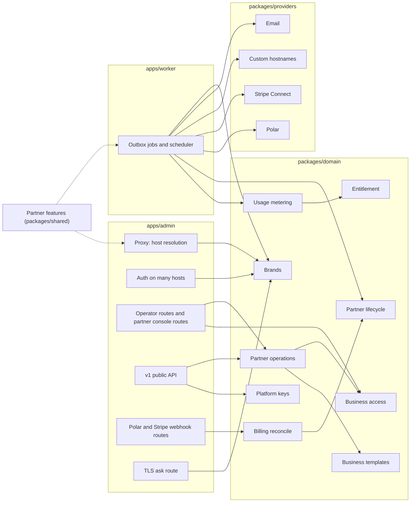

# Understand the partner program's architecture

This page defines the modules the partner program adds or changes, the interface of each, and how requests, usage, and billing flow between them. [How partners resell LobbyStack](../white-label.md) records the product decisions, and [Build the partner program](../white-label-build-plan.md) orders the work. Terms follow [`GLOSSARY.md`](../../GLOSSARY.md).

The design keeps each rule in one module. Callers see a small interface and don't need to know whether a business is direct or belongs to a partner. A caller that reserves voice minutes, for example, never learns that a pool exists.

## Module map



| Module | Lives in | Interface | Hides |
| --- | --- | --- | --- |
| Partner features | `packages/shared` | `partnerFeatures(env)` | Which configuration turns which feature on |
| Brands | `packages/domain` | `resolveHostBrand`, `brandForBusiness` | Host parsing, domain lookup, caching, merging with the host brand |
| Business access | `packages/domain` | `requireBusinessAccess`, `openPartnerBusiness` | Memberships, partner members, audited opens, access levels, brand matching |
| Partner operations | `packages/domain` | Functions that take a `PartnerActor` | Owner-less businesses, invitations, release, delete, branding, settings, team |
| Entitlement | `packages/domain` | `loadEntitlement` | Plans, packages, billed-outside businesses, Stripe and tier state, grace periods |
| Usage metering | `packages/domain` | `reserveUsage`, `extendUsage`, `correctUsage` | Allowances, pools, caps, lock order, sync jobs |
| Partner lifecycle | `packages/domain` | `nextPartnerState`, `applyPartnerTransition`, `advancePartnerLifecycles`, `getPartnerLifecycle` | The 30-day and 90-day steps, and what each step does to businesses and numbers |
| Platform keys | `packages/domain` | `resolvePlatformKey` | Environment and database key sources, groups, what each key may do |
| Business templates | `packages/shared` and `packages/domain` | `applyBusinessTemplate`, `exportBusinessTemplate`, `saveBusinessTemplate` | Reading a setup, comparing, changing only what differs, and the copies of a template's documents |
| Prospect demos | `packages/domain` | `createPartnerDemo`, `listPartnerDemos`, `claimProspectDemo` | The host's demos and a partner's, the brand a demo names and opens on, and what claiming one keeps |
| Billing reconcile | `packages/domain` | `reconcilePartnerTier`, `reconcilePackageSubscription` | Ordering, stale snapshots, and mapping provider states |
| Stripe Connect | `packages/providers` | `StripeConnectProvider` | The Stripe API and the `Stripe-Account` header |
| Custom hostnames | `packages/providers` | `CustomHostnameProvider` | Cloudflare for SaaS, or Caddy with a DNS check |

## Partner features

`partnerFeatures(env)` answers one question for the admin and the worker: what's turned on in this deployment. Both runtimes call it, so they never disagree.

```ts
type PartnerFeatures = {
  enabled: boolean;
  signup: "open" | "invite";
  baseDomain: string | null;            // PARTNER_BASE_DOMAIN
  stripeConnect: boolean;               // keys and webhook secret present
  tierBilling: boolean;                 // every POLAR_PARTNER_<TIER>_<INTERVAL>_PRODUCT_ID present, each its own product
  customDomains: "cloudflare" | "caddy" | null; // CLOUDFLARE_SAAS_API_TOKEN and CLOUDFLARE_SAAS_ZONE_ID, or CADDY_ON_DEMAND_TLS=true
};
```

Every other module reads features through it instead of reading environment variables. A missing piece degrades the way [the decisions](../white-label.md#self-hosted-deployments) describe: no Stripe Connect means every partner business is billed outside LobbyStack, and no tier billing means a partner's pool has no limit unless the host sets one.

## Brands

Brands decide which brand a request or a business shows.

```ts
type Brand = {
  kind: "host" | "partner";
  partnerId: string | null;
  name: string;
  logoUrl: string | null;
  faviconUrl: string | null;
  color: string | null;
  origin: string;                       // https://acme.receptionistportal.com
  links: { website: string | null; terms: string | null; privacy: string | null; support: string | null };
  email: { fromName: string; fromAddress: string; replyTo: string | null };
};

resolveHostBrand(context, host: string): Promise<Brand | null>
brandForBusiness(context, businessId: string): Promise<Brand>
```

- `resolveHostBrand` returns the host brand for the host's own domain, a partner's brand for a subdomain of the partner base domain or a verified custom domain, and `null` for any other host. The proxy answers `null` with a 404.
- `brandForBusiness` returns the partner's brand for a partner business and the host brand otherwise. The worker calls it when it renders an email, so a brand change applies to emails still in the queue.
- The module caches answers per process, misses included, and clears them when a partner's domain or brand changes through a Redis message.
- The host brand still comes from today's [deployment branding](../branding.md). Texts always use the host brand, so the SMS code keeps calling `deploymentAppName()` and never calls this module.

## Business access

Business access decides whether a person may act in a business, and what they may do there. Every operator route and every RLS check rests on it.

```ts
type BusinessAccess = {
  businessId: string;
  via: "membership" | "partner";
  role: "business_owner" | "business_admin" | "scheduler" | "viewer"; // an admin's through a partner open
  partnerRole: "owner" | "admin" | "member" | null;                    // set through a partner open
  partnerId: string | null;
  accessLevel: "full" | "activity" | null;
  can: (capability: Capability) => boolean;
};
type Capability = "activity" | "setup" | "team" | "billing" | "api_keys" | "mcp";

requireBusinessAccess(tx, input: { userId: string; businessId: string; brand: Brand }): Promise<BusinessAccess>
openPartnerBusiness(context, input: { userId: string; businessId: string; partnerId?: string }): Promise<{ expiresAt: Date }>
```

- `requireBusinessAccess` refuses a business whose brand differs from the request's brand, so a business never shows on another brand's domain. A business of another brand gets the same refusal as one the person isn't on. It replaces `requireBusinessMembership` in `forBusiness`.
- An operator of a partner business gets `activity` at the activity-only level, and `activity`, `setup`, and `team` at full access. They never get `billing`, `api_keys`, or `mcp`.
- Each operator route in the admin needs one capability, from the table in `apps/admin/src/lib/business-capabilities.ts`. `forBusiness` checks the brand and the capability before the handler runs, matching the decoded path, and a route missing from the table needs `setup`.
- The functions behind Polar checkout, managed plans, the overage cap, operator API keys, webhooks managed from the dashboard, and MCP tokens refuse a partner business too, whatever brand the request came from. MCP's consent screen lists only direct businesses.
- The dashboard remembers, per brand, the business a person last opened on that brand's domains.
- The dashboard hides each page the business doesn't give the person, from the table in `apps/admin/src/lib/dashboard-pages.ts`. The workspace list carries each business's capabilities for it.
- On a partner's domain, a signed-in person with no business there gets a "no businesses" page instead of onboarding, since that domain makes no direct business.
- A partner member reaches a business only after `openPartnerBusiness`. That writes the open with its expiry and an `audit_logs` row in one transaction. In the database, `app.has_partner_access(business_id)` checks the same open, so RLS and the application agree.
- An open lasts 8 hours, and opening again starts the time over. The `partner_business_opens` table keeps one row per person and business, and the audit log gets a `partner.business_opened` row for every open, naming who opened it, when, and until when.
- Going back to the console or signing out ends the open, through `leavePartnerBusiness`, and the audit log gets a `partner.business_left` row. The dashboard reads when its open began as it loads and ends only that one, so a newer open from another tab stays. Closing the tab ends nothing: the 8-hour expiry covers it.
- The business's owners and admins see the opens and leaves on the Partner access tab in Settings, through `listPartnerAccess`. It shows the person's name as it was when they opened the business, or "A member of" the partner's team without one, and never their email or partner role. The rows keep the partner's name, so they read the same after the person leaves the partner or the partner releases the business.
- An open counts only while the business still belongs to the partner that opened it and the person is still on that partner's team. Releasing the business or removing the member ends the access at once. An invitation to the business's team that someone off the team sent, such as a partner member through an open or a partner admin inviting the owner, works only while its sender is still on the partner's team, so it can't outlast them.
- `openPartnerBusiness` refuses a business of another partner, a direct business, and anyone off the partner's team. It answers each with a 404, like a business that doesn't exist. The console passes its own partner, so it can't open another partner's business either. The open also makes the business the person's active one on the partner's domains.
- Through an open, a partner member gets full access whatever the business's access level: `activity`, `setup`, and `team`, never `billing`, `api_keys`, or `mcp`. The business's rules see an admin's role, so a partner member never takes an owner's place.
- A partner open doesn't reach the business's Billing tab, where its own owners and admins pay the partner: `getPackageBilling`, `startPackageCheckout` and `openPackagePortal` check `requireTeamMembership`.
- `app.has_business_membership` answers true for the business's own team or a partner open, so every tenant policy lets the open in. `app.has_team_membership` keeps the old answer for functions that act for the team only.
- Partner members never join the team. `inviteMember` refuses an address on the business's partner's team, and `acceptInvitation` refuses anyone on it, with `partner_member_not_on_team`. `createPartnerBusiness` refuses an owner on the partner's team. `app.is_partner_member_email` answers the address check only for someone on that partner's team, so a business's own operators learn nothing of it.
- `app.list_business_members` lists only the business's own operators, and alert recipients and owner lookups read only memberships. Only the team verifies a phone for SMS alerts, and only the team's verification finishes the owner's onboarding, because a partner's business forwards calls to its owner's verified phone. A partner member verifies their own mobile in the business only to claim the partner's trial number, as [Phone numbers](#phone-numbers) describes.
- `requireBusinessMembership` counts a partner open as an admin's role, and `requireTeamMembership` counts only the team. Every runtime role may call `app.partner_access_role`, which answers only for the current person, so the check works on the worker's connection too. A per-business API key acts for its creator only while they're on the team.
- The workspace list includes the businesses a person has open, with `via: "partner"`. Onboarding belongs to the owner, so a partner member who opens a business goes straight to its dashboard.
- The scheduler counts an open in the last 30 days as use, so a business the partner sets up before its owner joins gets its jobs.
- Direct businesses keep today's rules for each role.
- Callers check capabilities, never roles. Adding a role or an access level changes this module only.

## Partner operations

Partner operations are what the console and a partner's platform keys can do. Both entry points call the same functions with a `PartnerActor`, so the console and the API can't drift apart.

```ts
type PartnerActor =
  | { kind: "member"; partnerId: string; userId: string; role: "owner" | "admin" | "member" }
  | { kind: "key"; partnerId: string; platformKeyId: string };
```

- The console's routes live under `/api/partner/*` in the admin and call these functions directly, the way the dashboard's operator routes call domain functions today. The v1 public API's Platform endpoints call the same functions for keys that belong to a partner.
- `createPartnerBusiness` creates a business with no owner, links it to the partner at the access level the partner picks, optionally applies a template, and sends the owner an invitation under the partner's brand. The invitation is never a claim link. A partner's businesses open only on its own domains, so the function refuses until the partner has its subdomain or a verified domain of its own. It never counts toward the cap of 10 businesses per account.
- `listPartnerBusinesses` gives each business's minutes and chats this month, as usage metering counts them. Row-level security shows a partner member none of a business's rows, so `app.list_partner_business_usage` reads the month's counts for someone on the partner's team. It leaves out the prospect demos nobody has claimed, which the Demos page lists instead.
- `releaseBusiness` needs an owner who accepted the invitation. It removes the partner, which leaves that person the owner, and puts the business on the host's Free plan. A trigger on `businesses.partner_id` then deletes the partner's opens of the business and the rows that remember it as someone's business on the partner's domains. Invitations to the business's team from anyone off the team stop working, including the ones a partner's key sent, which name no inviter. Webhook endpoints that a platform key or one of the partner's people set up turn off, as a claim link's hand-over turns off a platform key's, so the business's calls, contacts and messages stop going to the partner. The owner's own endpoints keep sending. The audit log records the release as `partner.business_released`, and each endpoint it turned off as `webhook_endpoint.disabled` with the reason `business_released`.
- `releaseBusiness` also drops the business's package, by the rule `setPartnerBusinessBilling` follows. While the subscription is live and the deployment would hear it end, it refuses with `subscription_active` until the partner cancels the subscription in Stripe. It closes any open checkout.
- `deletePartnerBusiness` deletes the business and every row that belongs to it, its audit log included. It drops the outbox messages that haven't gone out, except the pool's alerts, which go to the partner's owners and admins. The worker skips an email whose business no longer exists, through `app.business_exists`, so an email that already left the outbox doesn't reach its people under the host's brand either. It sends a pool alert all the same.
- `deletePartnerBusiness` queues `phoneNumber.releaseDeleted` for each number the business held, and the worker releases each one with the provider. It skips the shared text sender, as a reclaim does. It also queues `privacy.deleteStoredObjects`, and the worker deletes the business's stored files. It queues both in the business, then deletes the business, which leaves them belonging to none. While a number is still being bought for the business, it refuses with `business_number_in_progress`, since the purchase would finish for a business that's gone. The partner lifecycle deletes businesses through the same `deletePartnerBusinessInTransaction`.
- `deletePartnerBusiness` refuses the same way while the business pays for a package through Stripe, and closes its open checkout, so its owner can't keep paying for a business that's gone. The partner lifecycle's deletion cancels that subscription itself first, as [Partner lifecycle](#partner-lifecycle) describes.
- `releaseBusiness` and `deletePartnerBusiness` take the team's or the number claims' advisory lock, then the billing account's, and only then the business's row lock. Team changes, claims and the Connect webhook lock in that order too.
- The Stripe page's functions (`getPartnerStripeConnection`, `startPartnerStripeOnboarding`) let only owners connect Stripe. The Packages page's (`listPartnerPackages`, `createPartnerPackage`, `renamePartnerPackage`, `archivePartnerPackage`) let owners and admins sell packages in the connected account's currency. Members see neither, and the database keeps each package on its partner's own connected account.
- `createPartnerBusiness` takes the package the business is sold, or none to bill it outside LobbyStack, and `setPartnerBusinessBilling` changes it until the business pays. Once the deployment can't hear that subscription end, after the partner disconnects its account or without Stripe Connect, the partner can change it again, and the change drops the subscription. Owners and admins see each business's package and payment status on the Businesses page. Members never see a business's billing, and the database sells a business only its own partner's packages.
- `setPartnerBusinessOverage` sets a business's overage on its package: on or off, the minute and chat rates, and a monthly cap, or none, each a whole number of the package currency's minor unit. Owners and admins set it from the Businesses page through `PUT /api/partner/businesses/overage`, and the business's audit log records each change as `partner.business_overage_changed`. Overage starts off, and turning it off keeps the rates and the cap. A business billed outside LobbyStack has none, so the function refuses it with `billed_outside`, and a deployment without Stripe Connect with `stripe_not_configured`.
- `billing_accounts` keeps the overage in `overage_enabled`, the two rates, `overage_cap_minor` and `overage_currency`, the package's currency when the partner set them (migration 0155). Terms in another currency than the business's package hold as off, so a business that moves to a package in another currency has no overage until the partner sets it again. Only the system actor writes these columns, as for the package, so a business's own operators can't raise their own cap. Releasing the business clears them.
- `getPartnerSettings` and `savePartnerSettings` back the console's Settings page through `GET` and `PATCH /api/partner/settings`. The page holds one setting, `partners.telemetry_enabled` (migration 0160), which works like `businesses.telemetry_enabled`: it starts on, everyone on the team sees it, and owners and admins change it, as a business's owners and admins change the business's. Platform keys can't read or change it. [Telemetry from the console](#telemetry-from-the-console) explains how the dashboard uses it.
- Each function checks the actor's role itself. A member can work inside businesses and see their usage, an admin can also manage businesses (create, release and delete them), packages, templates, branding, domains, keys, settings, and the team, and only an owner can manage billing, Stripe and owners. No function deletes a partner yet, though the product decisions give that to owners. An admin can invite, change and remove admins and members, but only an owner can grant the owner role or change or remove an owner.

## Entitlement

Entitlement replaces checks of a plan's slug. It tells every caller what a business may use right now.

```ts
type Entitlement = {
  live: boolean;                        // on a live paid plan or package: dedicated numbers and paid features
  source: "plan" | "package" | "billed_outside" | "unlimited";
  allowance: { voiceSeconds: number | null; chats: number | null; alertSms: number | null; outboundAttempts: number | null };
  overage: { enabled: boolean; currency: string; rates: { voiceMinute: number; chat: number; alertSms: number; outboundAttempt: number }; capMinor: number | null };
  poolPartnerId: string | null;         // usage also draws on this partner's pool
  includedNumbers: number | null;
};

loadEntitlement(tx, businessId: string): Promise<Entitlement>
```

- A direct business gets its plan from the plan catalog, as today. A self-hosted server's businesses get `source: "unlimited"`. A partner business gets its package, or no limit when it's billed outside LobbyStack. It is `live` only while its Stripe subscription is `active`, `trialing` or `past_due` (unless billed outside), and while its partner's businesses answer: until 30 days after the partner's tier ended or a payment for it failed, as [Partner lifecycle](#partner-lifecycle) describes. A partner business with no package is billed outside LobbyStack, and so is every partner business on a deployment without Stripe Connect. A live business on a package gets the package's minutes and chats, and the overage its partner set for it: the minute and chat rates and the cap, with `alertSms` and `outboundAttempt` at 0. A business that isn't live gets no overage, whatever the partner set. Every partner business has its partner as `poolPartnerId`. Its partner's tier sets how many numbers the partner's businesses hold between them, as [Phone numbers](#phone-numbers) describes.
- A direct business that isn't `live` still answers within its Free allowance. A partner business that isn't `live` gets an allowance of 0, so usage metering refuses its calls and chats the way it refuses any business at its limit: calls forward and chat shows its "can't reply" message.
- `hasLiveEntitlement(account)` in `packages/shared` answers `live` from a billing account. The browser and the Polar reconcile use it on account snapshots. For a direct business's own account, it matches `loadEntitlement(...).live`. A partner business on a package gets `live` from `hasLivePackageSubscription(state)` on its Stripe subscription's state instead, and one billed outside LobbyStack is always live. It replaces `isPaidSubscription` in TypeScript. The number-claim SQL calls `app.has_live_entitlement(business_id)`, which applies the same rule, packages and the partner's lifecycle included. SQL can't read the deployment's configuration, so on a deployment without Stripe Connect it still asks a business on a package for its subscription. Only the number claims ask it, so on the cloud such a business gets no new number until its subscription is live again.
- Direct Starter and Pro plans charge alert texts and outbound attempts against the cap. `rates` carries `alertSms` and `outboundAttempt` for them, beside the minute and chat rates.
- Amounts are in the minor unit of `currency`, so caps work in a partner's currency.

## Usage metering

Usage metering keeps the interface it has today and gains the pool behind it.

```ts
reserveUsage(tx, input: { businessId: string; kind: UsageKind; sourceKey: string; quantity: number }): Promise<Reservation>
extendUsage(tx, input: { businessId: string; sourceKey: string; quantity: number }): Promise<Reservation>
correctUsage(tx, input: { businessId: string; sourceKey: string; quantity: number; final: boolean }): Promise<void>

type Reservation =
  | { allowed: true; granted: number }
  | { allowed: false; reason: "voice_limit_reached" | "chat_limit_reached" | "alert_sms_limit_reached" | "outbound_limit_reached" };
```

- Reserving loads the entitlement, then takes the business lock, then the pool lock when `poolPartnerId` is set, in that order every time. It grants the smaller of what the business has left and what the pool has left. Top-ups and corrections take the same locks in the same order. The business lock is `billing-usage:<business id>:<period>`, and the pool lock is `billing-pool:<partner id>:<period>`.
- The pool lives in `partner_usage_months`, one row per partner and month. It keeps running counts: voice seconds with open reservations included, the seconds of calls that ended, chats, and the overage. Each reservation, top-up and correction moves the counts by what it changed, so no reservation replays the other businesses' events.
- The database reaches the pool only through SECURITY DEFINER functions, because a business's transaction can't read its partner's other businesses. `app.lock_partner_pool` takes the pool lock and reads the pool, and `app.record_partner_pool_usage` moves its counts. Both answer only the worker inside one of the partner's businesses, or inside one whose usage drew on the pool that month before it left the partner. `app.partner_pool_month` reads the pool without the lock, for those callers and for an operator on the partner's team.
- What the pool has left is what it includes, plus what the cap still pays for at the tier's rates while overage is on. Open reservations count against the cap at the minute rate. With overage off, on Free, or past the cap, the pool has only what it includes. Without tier billing, only a pool the host set limits it, and the pool counts either way.
- Pool overage is on by default. An owner turns it off, or sets a monthly cap in US cents, on the console's Billing page through `setPartnerPoolOverage`. `app.set_partner_pool_overage` writes both settings to `partner_billing_accounts`, and the tier reconcile keeps them.
- On a deployment that bills no tiers, the host sets a partner's pool with `pnpm partner-pool:set`, which calls `setPartnerHostPool`. The command names the partner by its id, its slug, its subdomain or its verified domain, and sets the minutes, the chats or both. A kind it leaves out keeps its limit, and `--clear` removes both. `app.set_partner_host_pool` writes `host_pool_voice_seconds` and `host_pool_chats` on `partner_billing_accounts` (migration 0158), each null for no limit. It answers only the system actor, so neither the partner's team nor a business's operators can change the pool.
- Nothing prices overage without tier billing, so the host's pool is the limit, with no overage and no cap. The pool's terms then carry `source: "host"` and overage off. Past the pool, reservations refuse calls with `voice_limit_reached` and chats with `chat_ai_limit_reached`, as on Free, so calls forward and chat shows its "can't reply" message. The checks that only decide whether to offer a browser call or a chat read the pool on every deployment too, so they agree with the reservation. A pool the host didn't set has no limit, as before.
- While the deployment bills tiers, the tier sets the pool and usage metering ignores the host's columns. `setPartnerHostPool` then refuses a limit with `tier_billing_on`, and still clears one. It checks the process's tier products and, in the database, what the worker last recorded in `partner_tier_billing`, since the shell that runs the command may lack the products. The reconcile never writes the host's columns, so a host that stops selling tiers gets back the pools it set.
- The tier's pool stays in `pool_voice_seconds` and `pool_chats`, which every reconcile rewrites from `partnerTierCatalog`, and `app.set_partner_pool_overage` fills with Free's when it makes the account. No tool wrote them for the host, and a change to them by hand lasted only until the partner's next Polar event. They keep that role, and the host's pool has its own columns, so a deployment that stops billing tiers doesn't hold partners to their last tier's pool.
- Every reservation stays idempotent per `sourceKey`, as today.
- The module records, on each usage event, the terms in force at the time. `terms_at_record_time` holds the business's allowance and overage, and the pool's tier, size, overage switch, cap and rates. A sync job therefore never re-reads a package or a tier that changed later. Voice and chat usage of a partner's business names its partner in `pool_partner_id`. The event stays on that pool even if the business leaves the partner mid-call. A phone call on a pool reserves its first slice even when nothing limits the pool, so its event names the pool and the terms from the call's start.
- Overage goes to the usage that ended past the pool. When an event turns final, the month's other final usage counts first, and the event records what it put past the pool and what that costs at its recorded rates. An open reservation records no overage until its call ends.
- A final event with pool overage queues `billing.syncUsage`, chats included. The worker sends Polar only that cost, in US cents, as `billing.partner_pool_voice_overage` or `billing.partner_pool_chat_overage` under the partner's customer, with `partner-pool:<event id>` as the event's id. Usage within the pool sends nothing, and the business's own Polar sync never runs, since the business pays the host nothing.
- Callers in calls, web calls, chat, alert texts, and transfers don't change. Running out of the business's allowance, the pool or the cap still raises `voice_limit_reached`, so calls forward the way commit `c5dd718e` set up, and chat answers `chat_ai_limit_reached`, so it shows its "can't reply" message. Alert texts and transfer attempts don't draw on the pool.
- A partner's business records each chat even when it has no allowance, since its chats draw on the pool and the console shows them.
- A business on a package with overage on keeps answering past its allowance, at its own rates, until what that costs reaches its cap. Open reservations count against the cap at the minute rate, and a chat counts its price, so a chat that would pass the cap is refused. A minute or chat rate of 0 makes that usage free, so the cap doesn't stop it. The reservation still grants no more than the pool has left, so the business falls back when either its cap or the pool runs out. With overage off or at the cap, it falls back the way an exhausted pool does: `voice_limit_reached` forwards calls, and `chat_ai_limit_reached` shows chat's "can't reply" message. Alert texts and transfer attempts, which a package doesn't sell, keep going past the cap, as they do once the pool runs out.
- The cap counts each calendar month in UTC, as the package's allowance does. Each package subscription renews at 00:00 UTC on the 1st, so each Stripe invoice covers the same month the cap counts. The first invoice charges the part of the month left when the owner paid, and the business still gets its package's full allowance for that month.
- Each event of a business on a package records the business's overage terms in `terms_at_record_time`, and the cap prices each event by the terms it recorded, so a rate the partner changes later doesn't reprice the month or a call already running. The cap itself is the one in force now.
- Once an event is final, it records in `business_overage_quantity` and `business_overage_minor` what it put past the business's own allowance and what that costs at its recorded rates, in the package currency's minor unit. As with the pool, the month's other final usage counts first, so open calls get none until they end. One call can put usage past both the business's allowance and the pool: its event then records both overages.
- A final event whose business overage moved sets `stripe_sync_status` to `pending` and queues `billing.syncUsage`. `sync_status` keeps following the pool's overage to Polar, and the same job sends both. The job runs the two reports apart: when one fails, the other still goes out, and the job then fails so its retry sends what's still pending. `syncBusinessOverage` sends the partner's Stripe what the event's overage moved since its last report, as a meter event on the partner's connected account for the business's customer, then marks the event `synced`. Usage within the allowance sends nothing.
- A report goes out once. Before the job asks Stripe, it writes the amount in `stripe_overage_sending_minor` and counts the report in `stripe_overage_reports` (migration 0156). The first report's identifier is the usage's source key, such as `voice:<call id>` or `chat:<conversation id>`, and a later correction's adds the report's number, such as `voice:<call id>:2`. A retry sends the same amount under the same identifier, which Stripe counts once, and Stripe's answer moves the amount to `stripe_overage_reported_minor`. A correction that lowers the overage sends the difference as a negative value.
- Each meter sums what the overage costs, in the currency's major unit, and its price charges one major unit for each, so Stripe charges what each event cost at the rates it recorded. The business's invoice shows each kind as one line, Call overage or Chat overage, with what it cost as the quantity at 1.00 each, such as 6.25 × CA$1.00, rather than as minutes or chats at the partner's rate. The first report of each kind adds the meter's price to the business's subscription, and `billing_accounts.stripe_overage_items` keeps the item for that subscription. Only the worker and the system actor write it. An event whose business has no subscription on its partner's account, or one that ended, is `skipped`. A failed report records `ops.billing.usage_sync_failed` with `provider: "stripe"`, and the job retries.
- The business's own owners and admins, and its partner's owners and admins, get an email at 80% and at 100% of its package's minutes and of its chats. Partner members and the business's other operators get none. Minutes count the calls that ended, rounded up to whole minutes. `queueBusinessAllowanceAlertsInTransaction` checks each change to the month's final usage, under the business's lock, and marks each alert in `billing_usage_months.alerts_sent`, so it goes out once a month. Its key names the allowance it measured, so a package of another size sends its alerts again. A change that reaches 100% at once sends only the 100% alert.
- These `business_allowance_alert` emails go out under the business's brand, which is its partner's, in the reader's language, and link to Settings > Usage on the partner's domain. They say whether the business keeps answering past its allowance, and name no prices. `app.business_allowance_alert_recipients` reads who gets them, and answers only the worker inside the business.
- The partner's copies, `partner_business_allowance_alert`, go out under the host's brand, since the partner is the host's customer. They link to the console's Businesses page on the host's domain, where the partner changes the business's overage, and also name no prices. `app.partner_pool_alert_recipients` reads who gets them. A business deleted before its alerts go out takes both copies with it.
- The partner's owners and admins get an email at 80% and at 100% of the pool's minutes, its chats, and the overage cap. Members get none. Minutes count the calls that ended, rounded as the Billing page rounds them. The cap counts what overage cost so far. A pool the host set alerts the same way, at its own size. Its emails carry `pool: "host"`, so they name no tier or overage and ask the partner to contact the host to change the pool.
- `queuePartnerPoolAlertsInTransaction` checks each change to the pool's counts, under the pool's lock. `app.claim_partner_pool_alerts` marks each alert in `partner_usage_months.alerts_sent`, so it goes out once a month. The function then queues one `partner_pool_alert` email per person, in the business's transaction. Deleting that business keeps the emails, since they go to the partner's people.
- An alert's key names the size of the pool or cap it measured, so a new cap or tier sends its alerts again. A change that reaches 100% at once sends only the 100% alert.
- The emails go out under the host's brand, since the partner is the host's customer. Each one uses the reader's language and links to the console's Billing page on the host's domain.
- Every operator sees the business's minutes and chats against its allowance on Settings > Usage. `readAllowanceUsageInTransaction` behind `/api/usage` reads them, needs only `activity`, and carries no prices or spend. A business on a package also sees there the minutes and chats it used past its allowance this month, which its partner bills, from each final event's `business_overage_quantity`, while its overage is on or once it has some. A business with billing also sees its plan's meters there. The pool stays off that page: only the partner's owners see it, on the console's Billing page, with this month's minutes and chats and the overage spent so far. Without tier billing, owners get the Billing page only once the host set the partner's pool, as `partnerHasBillingPage` answers the console's layout. The page then shows this month's use against that pool, with no tier, prices or overage. A kind the host left with no limit shows its use alone.

## Phone numbers

A partner's tier sets how many phone numbers its businesses hold between them. Tier billing, as `partnerFeatures(...).tierBilling` decides, sets who counts them and who pays for the extra ones:

| Deployment | Tier billing on | Tier billing off |
|---|---|---|
| Cloud | The claims count the partner's numbers against its tier, and the worker charges the partner for each one past the included ones. | The claims refuse every new number with `partner_numbers_unavailable`, since nobody would pay for it. A replacement for a number the business holds still goes through. |
| Self-hosted | Same as the cloud. | No tier limit and no charges. The claim quotas still apply. |

- Only the environment knows whether the deployment bills tiers, so the worker records it in `partner_tier_billing` when it starts and on each run of `billing.chargePartnerNumbers`. Until the worker first records it after migration 0147, the deployment bills no tiers, so the cloud refuses partners' new numbers.
- Every claim, from onboarding, a replacement, a trial or the API, writes a row in `onboarding_number_claim_events`. A trigger on that table takes the partner's lock after the business's, so two of the partner's businesses claim in turn.
- The partner holds its businesses' active numbers that aren't scheduled for release, plus the new numbers that claims are buying now.
- While the deployment bills tiers, a claim for a new number past the tier's included numbers needs a paid tier. Free includes none, so a business of a Free partner gets only the partner's trial number. A replacement adds no number, so the count skips it.
- A partner's business never gets the host's free trial number. One that isn't `live`, such as a business whose package isn't paid, gets `partner_numbers_unavailable` from the number search and the claims on the cloud.
- A partner on Free gets one 14-day trial number, ever, for one of its live businesses. A paused business isn't live, so it gets none. A demo nobody claimed gets none either: it expires, and the partner would lose its one trial with it. The cloud offers the trial while the deployment bills tiers. The host's trial rules apply:
  - The business's owner or admin can claim it, and so can a partner member who opened the business.
  - The person claiming verified their own mobile in the business, in a trial country. As on direct Free, a person or a phone that had a trial anywhere gets no second one.
  - The trial lasts 14 days, and calls transfer only to that mobile. `number_trials.verified_phone` records it, whoever claims.
  - Its calls use the pool's minutes. Minutes that the partner's other businesses hold for calls still running can refuse one of its calls, which then forwards. The trial number switches to forwarding only when ended calls used up the minutes.
- The dashboard's phone settings offer the trial when `partnerNumberAvailabilityInTransaction` answers `trial: true`, and the number search signs a trial offer. The claim check refuses a second trial with `partner_trial_used`, and a paid tier's with `trial_not_needed`.
- `GET /api/phone-numbers` also says whether the person has a verified mobile in the business. When they don't, the settings verify one before the number chooser opens, through the onboarding phone step's routes. `startOnboardingPhoneVerification` lets a partner member in only while the business is offered the trial, and only from a trial country. Their verification sets their own phone, and `app.complete_phone_verification` leaves the owner's onboarding where it was (migration 0159).
- A trigger sets `number_trials.partner_id` from the business and keeps it. A partial unique index holds each partner to one trial that a failed purchase didn't end. A trial claim that stalled in one of the partner's businesses expires when another of them claims the trial, as it would in its own business. Deleting the partner clears `number_trials.partner_id`. When the trial starts, `partners.number_trial_started_at` records it, so deleting the business that held it gives the partner no second trial. A business the partner releases keeps its trial, which then runs as the host's.
- When the partner pays for a tier, the worker runs `keepPartnerTrialNumber` after it reconciles the tier. The trial number then becomes one of the partner's numbers, counted against the tier. A trial number the worker buys after the partner paid converts at once.
- The host's trial emails carry the host's prices, so a partner's business gets none, whoever claimed its trial.
- The claim quotas apply on every deployment:
  - Each business makes at most 3 claims an hour.
  - With tier billing, the partner's businesses share quotas sized from the tier in force. They buy up to the larger of 2 and the tier's included numbers a day, and the larger of 5 and twice those in 30 days. Scale, with 25 included numbers, buys up to 25 a day and 50 in 30 days.
  - Without tier billing, the partner's businesses share 2 numbers a day and 5 in 30 days.
- A partner member's claims count against these quotas only. The per-user cap of the dashboard's claims and an API key's (3 claims an hour, 2 numbers bought a day and 5 in 30 days) skips a claim made through an open. `onboarding_number_claim_events.by_partner_member` marks those claims, so the member's own cap leaves them out in their other businesses too. The business's own team, and every direct business, keep the per-user cap (migration 0159).
- The shared quotas count the numbers bought in their window and the claims still buying one. Claiming from many new businesses at once doesn't get a partner past them.
- `numberEligibilityInTransaction` reads the same count through `app.partner_number_standing` and applies the same rules through `newPartnerNumberRefusal`, so the number search refuses before it asks the carrier. A partner's business has no billing capability, so the dashboard's phone settings read `partnerNumberAvailabilityInTransaction` from `GET /api/phone-numbers` instead of the business's plan. The console's Billing page shows the count to the partner's owners.
- `partnerNumberAvailabilityInTransaction` also gives the claim's `refusal` when the business can't get a new number:
  - `partner_number_limit_reached` when only a paid tier would give it one. The settings then say "This business's partner needs a paid tier to add phone numbers."
  - `partner_numbers_unavailable` on the cloud without tier billing, and `invalid_onboarding_stage` until the owner finishes onboarding, since a partner member can open the business before then. No tier helps there, so the settings say "Phone numbers aren't available for this business yet."
- Before it buys a number that counts against a partner's tier, the worker reads what Twilio charges the host for it each month, and stores that in `partner_number_charges`.
- The hourly `billing.chargePartnerNumbers` job settles each month of each number. The partner's oldest numbers are the included ones. Each month of a number past them, on a paid tier, goes to Polar as a `billing.partner_extra_numbers` event under the partner's customer.
- A number scheduled for release settles its months uncharged, so a cancelled release charges no month late. A released number, or one whose business left the partner, settles no more months.
- When Polar refuses one of a partner's charges, that partner's charged months wait for the next run. Every other month still settles, and the job then fails with the count of charges that wait.
- The Billing page shows each tier's price, pool and included numbers from `partnerTierCatalog` on every deployment that bills tiers, and the reconcile records the same pool and included numbers. A self-hoster's Polar products must charge the catalog's prices.

## Partner lifecycle

The lifecycle is a pure function plus one module that applies its result.

```ts
type PartnerState = "active" | "past_due" | "ending" | "paused" | "deleted";
type PartnerEvent = { kind: "tier_paid" | "tier_failed" | "tier_cancelled" | "clock"; at: Date };
type PartnerStanding = { state: PartnerState; since: Date; tierEndedAt: Date | null };

nextPartnerState(current: PartnerStanding, event: PartnerEvent): PartnerStanding
applyPartnerTransition(tx, input: { partnerId: string; from: PartnerStanding; to: PartnerStanding; event: PartnerEvent }): Promise<number>
advancePartnerLifecycles(context, input?: { now?: Date }): Promise<{ moved: number; deleted: number; waiting: number }>
getPartnerLifecycle(context, actor: PartnerActor): Promise<{ state: PartnerState; tierEndedAt: string | null; pausesAt: string | null; deletesAt: string | null }>
```

- A partner stays `active` until a paid tier ends or a payment for it fails, so a partner on Free that never paid never enters the lifecycle. A failed payment makes it `past_due`, and its tier stays in force while Polar retries. A paid tier that ends makes it `ending`, whether the partner cancelled it or Polar revoked it. Paying for a tier again makes it `active` from any state.
- The businesses pause 30 days after the failed payment or the tier's end, whichever came first. Polar's retries failing don't start the days over. The host deletes them 90 days after the tier ended. After a failed payment, the tier ends when Polar revokes it, so a partner still `past_due` has no deletion date yet.
- During `past_due` and `ending`, the businesses answer and the partner can release them. A released business is direct from then on, so the later steps pass it by. When the 30 days are up, the clock makes the partner `paused`. `loadEntitlement` then gives its businesses `live: false` and an allowance of 0, so their calls, browser calls and chats get nothing, whatever the partner's pool has left. `reserveUsage` refuses their calls with `voice_limit_reached`, so the live webhook answers 503 and the trunk fails the call over to `/api/webhooks/twilio/voice`, which forwards it to the business's transfer number or its owner's verified phone. Chat shows its "can't reply" message, and the number claims refuse them. Ninety days after the tier ended, the clock makes the partner `deleted`, and the same hourly run deletes its businesses.
- Each step's `since` is its deadline, not the time the job noticed it, so a late run moves no deadline. While a partner is `past_due` or `ending`, `since` is when its 30 days began. `tierEndedAt` is when the tier ended, and a `paused` partner learns it when Polar revokes a tier it paused under. A run that missed the 30-day step goes straight to `deleted` at 90 days.
- `partner_lifecycles` stores each partner's state, `since` and `tier_ended_at` (migration 0150). A partner with no row is `active`. The partner's team reads it, and only the worker writes it. RLS hides it from a business's own operators, so `loadEntitlement` asks `app.partner_business_answers(business_id)`, which answers inside the business.
- Once a partner reached `deleted`, a business it makes later answers as any Free partner's does, since the partner is on Free. The deletion covers only the businesses the partner had when it reached `deleted`.
- `reconcilePartnerTier` compares the tier in force before and after each Polar event, and sends the event the change makes. It dates the event with Polar's times: when the subscription ended, or when it last changed.
- The hourly `partnerLifecycle.advance` job calls `advancePartnerLifecycles`. It sends a clock event to each partner due to pause or reach deletion, each in its own transaction. Every step takes the partner's lifecycle lock, so the job and a reconcile never apply steps at once.
- `applyPartnerTransition` stores the step, records it in `partner_lifecycle_events` as `partner.lifecycle_changed`, and writes it to the audit log of each of the partner's businesses. A business's audit log goes with the business, so `partner_lifecycle_events` is the record that outlives it. The worker only adds rows to it, and the partner's team reads it.
- `applyPartnerTransition` takes the worker's transaction and only stores the step, so a Polar reconcile applies the step in the same transaction as the tier change. The pause needs no write to the businesses, since `loadEntitlement` reads the state. Deleting the businesses takes a transaction each and a call to Stripe, so `advancePartnerLifecycles` does it after the step to `deleted` commits.
- The host deletes each business a `deleted` partner had when it reached deletion, with `deletePartnerBusinessInTransaction`, the function behind `deletePartnerBusiness`, `deletePartnerDemo` and the cleanup after a failed template. Each number the business held goes back to the provider through `phoneNumber.releaseDeleted`, its files through `privacy.deleteStoredObjects`, and its rows, audit log included, go with it. The worker finds the businesses through `app.partner_businesses_due_for_deletion` (migration 0151), since RLS shows it none before it deletes one, and deletes each in its own transaction, under the partner's lifecycle lock, scoped to the business. Each deletion goes to `partner_lifecycle_events` as `partner.business_deleted`, with the business, the numbers it released and the subscription it cancelled. The pool's month in `partner_usage_months` is the partner's, so it keeps the usage of the businesses the host deletes, and the pool alerts their usage queued still go out.
- A prospect demo nobody claimed is one of the partner's businesses, so the host deletes it with the others, and its `prospect_demos` row goes with its business. The partner's templates and their stored copies stay, since they belong to the partner.
- Before it deletes a business that pays for its package through Stripe, the worker closes the business's open checkout and cancels the subscription on the partner's connected account through `StripeConnectProvider.cancelSubscription`, so the owner pays nothing more for a business that's gone. Stripe ends it at once. The worker gets the Stripe Connect client from the same two variables as the admin. When Stripe refuses, the business waits for the next run and the job fails, so the queue shows it. A deployment without Stripe Connect can't reach the subscription, so it deletes the business as the partner's own delete would there.
- The deletion takes a suspended business too. A business whose number is still being bought waits for the next run, and `app.business_number_claim_in_progress` answers the worker for that. So does one whose owner started a new subscription after the worker cancelled the last.
- `getPartnerLifecycle` gives the console the partner's state and three dates, each null while it isn't known: when the tier ended, when the businesses pause, and when the host deletes them. Owners and admins read it, and members get a 403. The Businesses page shows it above the businesses through `GET /api/partner/lifecycle`, with what an owner or an admin can do: update the card while the tier is past due, pay for a tier on the Billing page once it ended, or release each business to its owner.
- `nextPartnerState` does no I/O, so its tests cover every transition without a database.

## Platform keys

`resolvePlatformKey` keeps one interface over two sources.

```ts
resolvePlatformKey(context, token: string): Promise<ResolvedPlatformKey | null>

type ResolvedPlatformKey = { platformKeyId: string; prefix: string; name: string; group: string; scopes: ApiKeyScope[]; createdAt: string } & (
  | { ownerEmail: string; access: "group" | "all" }       // the host's, from PLATFORM_API_KEYS
  | { partnerId: string; access: "group" }                 // a partner's, from partner_platform_keys
);
```

- The module checks `PLATFORM_API_KEYS` first, then `partner_platform_keys`, which keeps only each key's SHA-256. It accepts the old `partner` field and access value as aliases ([ADR 0010](../adr/0010-partners-make-their-own-platform-keys.md)).
- A partner's key uses the partner as its group. Each business of the partner joins that group in `platform_key_businesses` when it's made, whether the console or a key made it, and leaves it when it leaves the partner. The database refuses to link any other business to a partner's group. A partner's key therefore reaches and lists businesses through its group, as a host's key does, and also checks that the business is still its partner's.
- A partner's key acts as the partner. Its v1 caller carries the partner instead of an account, and partner operations see it as a `PartnerActor` with `kind: "key"`. It can never have `access: "all"`, managed plans, claim links, or Polar checkout, and the database enforces the first with a CHECK.
- `createPartnerPlatformKey`, `listPartnerPlatformKeys`, and `revokePartnerPlatformKey` are partner operations for owners and admins. The console's API keys page calls them through `/api/partner/platform-keys`.
- Revoking a key, in the same transaction, turns off the webhook endpoints it set up and revokes the team invitations it sent that nobody accepted. The owner invitations it sent as it created businesses stay, since the console can't send another. A request with a partner's key holds a share lock on the key's row while it creates a webhook endpoint, an invitation or a business, so a revoke waits for it and catches what it wrote.
- The startup webhook cleanup passes the ids in `PLATFORM_API_KEYS`. In the same statement, the database keeps the endpoints of a partner's key while the key isn't revoked and still reaches the business.
- `POST /businesses` with a partner's key calls `createPartnerBusiness` with the key as the actor, on the app role, since only it can act as the system. The request names the owner in `owner_email` and the access level in `access_level`. The Idempotency-Key decides the business's id, as it does for a host's key.
- A partner's key invites people as the partner: the owner when it creates a business, and staff through `POST /team/invitations`. Those invitations carry `invited_by_platform_key_id` and no person. A claim link always names the account that sent it. `POST /users` sends its email under the partner's brand.
- A partner can make as many keys as it likes, so the limits on what its keys send count against the partner: 30 new businesses an hour, 20 team invitations an hour, and the daily `POST /users` invitations.
- Operations that act as a person stay closed to a partner's key: number search and claims, and reading or changing alert preferences.
- Links in API responses point at the business's own dashboard: the widget's script tag and the calendar connect link use the partner's origin for a partner's business, and `APP_BASE_URL` for a direct one. The connect route keeps a signed-out visitor's sign-in, its errors and the finished connection on the domain it was opened on, as [A Calendar or Instagram connection on a partner's domain](#a-calendar-or-instagram-connection-on-a-partners-domain) describes.

## Business templates

Templates reuse the `lobbystack onboard` file format. A template is a manifest without the parts that belong to one business.

```ts
// packages/shared
applyBusinessTemplate(port: BusinessSetupPort, template: BusinessTemplate, options?: { plan?: boolean }): Promise<ApplyResult>

// packages/domain
exportBusinessTemplate(context, actor: PartnerActor, businessId: string): Promise<BusinessTemplate>
saveBusinessTemplate(context, actor: PartnerActor, input: { businessId: string; name: string }, dependencies: { storage }): Promise<PartnerTemplate>
listBusinessTemplates(context, actor: PartnerActor): Promise<PartnerTemplate[]>
deleteBusinessTemplate(context, actor: PartnerActor, input: { templateId: string }): Promise<void>
```

- `packages/shared/src/businessSetup.ts` holds the manifest schema, `businessTemplateSchema`, the `BusinessSetupPort` interface, and the compare-then-change steps that `lobbystack onboard` used to keep in `onboard.ts`: business details, receptionist, services, rules, websites, FAQs and texts. The schema has no local file reading; `packages/cli/src/manifest.ts` reads the file and checks it against the schema.
- The port has two adapters. The CLI's, in `packages/cli/src/setupPort.ts`, calls the v1 API over HTTP. The domain's `inProcessSetupPort` calls the same `*ForApi` operations in-process, as a `PartnerMemberCaller`, so the business's audit log names the partner member. That caller acts for the partner, as a partner's key does, so the operations refuse it a Polar checkout, a claim link and a managed plan. The CLI calls the steps one by one, because it puts its plan, documents, number and claim link between them, and its behavior didn't change. The console calls `applyBusinessTemplate`, which runs the steps in onboard's order.
- A template leaves out the business's id and slug, plan, phone number, transfer number, owner, onboarding, access level and the staff who take each service. It also leaves out entries, websites and documents the business turned off, the greeting written for the business's name, and a summary no person wrote. A setup the format can't hold, such as a rule longer than calls read, is refused with `template_invalid`.
- The business's own website describes that business only, so a template leaves out `website_url` and every website source on the same host, ignoring a leading `www.`. A website source on another host stays. A template also leaves out the booking policy and voice and text instructions a prospect demo writes for itself while they're unchanged.
- Saving or exporting a template reads the business without an open, so the business's audit log gets a `partner.business_setup_exported` row in the same transaction as the read. It names the partner member and their role, and the template's id and name when the read was for a save.
- `business_templates` keeps each template under its partner, and `business_template_files` keeps a stored copy of each document, so a template outlives the business it came from. Anyone on the partner's team reads them, and owners and admins save and delete them. Row-level security checks `app.partner_role` on every statement, and a template never changes once saved. Deleting a template queues `privacy.deleteStoredObjects` for its copies.
- `createPartnerBusiness` takes an optional `templateId` and the worker's context, because the `*ForApi` operations run as `lobbystack_worker`. It applies the template after it creates the business and before it invites the owner. The business keeps the name and time zone the console sent. If the template can't be applied, the function deletes the business and answers `template_failed`, so the owner never hears of a business that isn't set up. It also deletes the business when the invitation fails after the template was applied. This cleanup skips the role check, since nobody else knows of the business, and deletes the business as `deletePartnerBusiness` does, so the worker deletes any document the template uploaded. A cleanup that fails is logged. That business then shows on the Businesses page with no owner, where an owner or admin can delete it.
- Only someone on the partner's team reads its templates, so `createPartnerBusiness` refuses a template from a platform key, and `POST /businesses` takes none. The console can send a package and a template together. The function sets the package when it creates the business, and the cleanup after a failed template deletes the package with the business.
- Applying doesn't wait for a website's sample read, so a template with `read_full_site` leaves the full read for the business's Knowledge page.

## Prospect demos

A partner's team makes prospect demos from the console under the partner's brand. A partner's demo is one of its businesses from the start, so it follows the rules of the host's demos and of the partner's businesses at once.

```ts
createPartnerDemo(context, actor: PartnerActor, input: { name: string; websiteUrl: string; accessLevel?: PartnerAccessLevel; greeting?: string; suggestedPrompts?: string[] }): Promise<{ demoId: string; businessId: string; token: string; url: string }>
listPartnerDemos(context, actor: PartnerActor): Promise<PartnerDemo[]>
publishPartnerDemo(context, actor: PartnerActor, input: { demoId: string; token: string }): Promise<{ status: "active"; expiresAt: Date }>
rotatePartnerDemoToken(context, actor: PartnerActor, input: { demoId: string }): Promise<{ token: string; url: string }>
revokePartnerDemo(context, actor: PartnerActor, input: { demoId: string }): Promise<void>
deletePartnerDemo(context, actor: PartnerActor, input: { demoId: string }): Promise<void>
claimProspectDemo(context, input: { userId: string; token: string; brand: BrandScope }): Promise<{ businessId: string; status: "claimed" | "already_claimed" }>
```

- Anyone on the partner's team makes, publishes, rotates and turns off the partner's demos: owners, admins and members alike. Only owners and admins pick a demo's access level and delete a demo, as they do for any of the partner's businesses. The host's demo operator, whom `PROSPECT_DEMO_OPERATOR_EMAIL` names, keeps managing the host's demos. `prospect_demos.partner_id` records the partner whose team made a demo, and the host operator's resolvers leave those demos out.
- The demo's business belongs to the partner and has no owner. It gets full access, unless an owner or admin picks activity only. A member who asks for activity only is refused with a 403. The partner's people work in it through opens, as in any of the partner's businesses, and the Demos page opens it the way the Businesses page opens a business.
- The demo's receptionist instructions name the brand that made the demo, from `brandForHostReference`: the partner's name for a partner's demo, and the host brand's for the host's own demos.
- A partner's demo link opens on the partner's domain, so making one needs the partner's subdomain, as creating a business does, and fails with `partner_domain_required` without it. The demo page's preview, its web call, and claiming each answer a token from another brand's demo as they answer an unknown one.
- A partner's demo calls count like those of any of the partner's businesses. The web call route marks them billable, so usage metering reserves and records their minutes under the business's entitlement, whose pool is the partner's. The Demos page shows each demo's minutes and chats this month. The host's own demos still don't count against minutes.
- A partner's demo has no package, so it's billed outside LobbyStack and draws on the partner's pool like any of its businesses. It pauses when the partner's other businesses do, as [Partner lifecycle](#partner-lifecycle) describes. Once someone claims it, its row on the Businesses page shows its billing, and an owner or admin can sell it a package there. Its numbers follow the partner's [number rules](#phone-numbers), so it never gets the host's free trial number, and it gets the partner's trial number only once someone claims it.
- The demo's business joins the partner's group in `platform_key_businesses` when it's made, as every business of the partner does. The partner's platform keys reach and list it, claimed or not, and a release takes it out of the group.
- Claiming a partner's demo on the partner's domain makes the prospect its owner, and the business stays with the partner at its access level. The owner's onboarding starts where an owner the partner invited would, and their dashboard opens on the business on the partner's domains. Someone on the partner's team can't claim it (`partner_member_not_on_team`). Only the partner hands the business over, by releasing it.
- Claiming a partner's demo also gives its receptionist the booking policy and voice and text instructions a new business gets, wherever the demo's own are unchanged, and refreshes the snapshot. At activity only the owner can't edit them, and real calls must not hear they're a demo. A setting someone on the team changed during the demo stays. The host's own demos keep today's claim.
- Publishing, rotating, turning off and deleting a demo lock its row first, as a claim does. A claim that finishes first leaves them with a claimed demo, which they refuse with `demo_claimed`, so none of them writes over a claim.
- A demo nobody has claimed stays off the Businesses page, and a claimed one moves there with its owner. Its owner joined by claiming it, so an owner or admin can release it there like a business whose owner accepted the invitation. A demo whose business the partner released leaves the Demos page.
- `deletePartnerDemo` deletes a closed demo nobody claimed, together with its business, as `deletePartnerBusiness` does. A demo is closed once someone turned it off or it passed its expiry, before the hourly sweep turns it off. It refuses a demo still open with `demo_open` and a claimed one with `demo_claimed`, since a claimed demo is deleted from the Businesses page. Like `deletePartnerBusiness`, it drops any package the business has, closes its open checkout, and queues the release of the business's numbers and the deletion of its stored files. `app.list_partner_prospect_demos` answers both pages, only for someone on the partner's team.
- The console's Demos page is the host's `LiveDemosSurface` on the routes under `/api/partner/demos`.

## Providers

Every outside service sits behind an interface in `packages/providers`. The worker gets them injected, as it gets Polar today, and tests pass fakes.

```ts
interface StripeConnectProvider {
  createOnboardingLink(input: { accountId: string | null; country: string | null; idempotencyKey: string; returnUrl: string; refreshUrl: string; metadata: Record<string, string> }): Promise<{ accountId: string; url: string }>;
  retrieveAccount(accountId: string): Promise<StripeConnectAccount>;
  upsertPackagePrice(accountId: string, pkg: PackageTerms): Promise<{ productId: string; priceId: string; setupPriceId: string | null }>;
  createCheckout(accountId: string, input: PackageCheckoutInput): Promise<{ sessionId: string; url: string; expiresAt: Date }>;
  expireCheckout(accountId: string, sessionId: string): Promise<void>;
  createPortal(accountId: string, customerId: string, returnUrl: string): Promise<{ url: string }>;
  retrieveSubscription(accountId: string, subscriptionId: string): Promise<StripeConnectSubscription>;
  cancelSubscription(accountId: string, subscriptionId: string): Promise<StripeConnectSubscription>;
  addOverageToSubscription(accountId: string, input: { subscriptionId: string; meter: "voice" | "chat"; currency: string }): Promise<{ subscriptionItemId: string }>;
  reportOverage(accountId: string, report: { identifier: string; customerId: string; meter: "voice" | "chat"; amountMinor: number; currency: string }): Promise<void>;
  verifyWebhook(body: string, signature: string): StripeConnectEvent;
}

interface CustomHostnameProvider {
  readonly kind: "cloudflare" | "caddy";
  create(hostname: string): Promise<{ id: string }>;
  status(id: string): Promise<{ state: "pending" | "active" | "failed"; records: DnsRecord[]; errors: string[] }>;
  remove(id: string): Promise<void>;
}

// The partner's proof that it controls its own domain: the TXT values at a DNS name.
type TxtLookup = (name: string) => Promise<string[]>;
```

- `StripeConnectProvider` has one production adapter, on Stripe's own SDK, and a fake in `packages/providers/src/stripe/fakeStripeConnect.ts` for tests. The adapter creates each partner's account with the full Stripe Dashboard, with Stripe collecting its fees from the partner and covering losses, as a standard account does. Stripe fixes an account's country when it creates it, so the console's Stripe page asks for the country first. Amounts stay in ISO 4217 minor units, and the adapter converts the few currencies Stripe counts differently.
- `upsertPackagePrice` creates a package's product, its monthly price and its optional one-time setup fee price on the partner's account. Later calls only rename the product or take the package off sale: its price and allowance never change, since businesses may already pay them.
- `createCheckout` opens a subscription Checkout on the partner's account for the package's monthly price and setup fee, with no application fee, so the subscription and its payments are direct charges. `billing_cycle_anchor_config` renews the subscription at 00:00 UTC on the 1st, and the first invoice charges the rest of the month with the full setup fee. Its metadata names the business and the package, on the checkout and on the subscription it starts. A business that paid before checks out on its earlier customer, so the partner's customer portal keeps every invoice. `expireCheckout` closes a checkout nobody should pay any more, such as one for a package the partner since replaced.
- `addOverageToSubscription` makes the partner's meter for a kind of overage, `lobbystack_call_overage` or `lobbystack_chat_overage`, and the meter's monthly price in the subscription's currency. It makes them the first time any of the partner's businesses needs them, finds the price again by its lookup key, and adds the price to the business's subscription. The prices' products are Call overage and Chat overage, the names the business's invoices show, and partners can rename them in their Stripe Dashboard. A price or product the partner archived there goes back on sale when a business needs it, since the lookup key still names it. `reportOverage` sends one meter event under its identifier, with an idempotency key, and takes Stripe's `duplicate_meter_event` as sent.
- `CustomHostnameProvider` has two production adapters in `packages/providers/src/customHostnames/customHostnames.ts`, and a fake beside them for tests. Cloudflare for SaaS serves the cloud: `create` registers a custom hostname with a DV certificate validated over HTTP, finds the one an earlier attempt or another partner's claim registered, and throws `CustomHostnameRefusedError` with Cloudflare's reasons when Cloudflare turns the hostname down. The Caddy adapter serves self-hosted deployments: it checks that every address the domain reaches is one of `PARTNER_DOMAIN_CNAME_TARGET`'s, and Caddy then asks `/api/tls/ask` before issuing a certificate. `kind` keeps a domain with the provider that set it up, so a deployment that changes provider leaves the other's domains alone. `systemTxtLookup` asks the system resolver for the partner's TXT record, and `FakeTxtRecords` stands in for it in tests.
- The Polar provider keeps its interface. Tier billing uses `partner:<id>` as the customer's external id, for the tier, extra numbers and pool overage. The webhook route stores a partner's events with `provider_events.partner_id` and no business, and the worker reconciles them with no business in its context.
- `loadPartnerTierInTransaction` answers what a partner's tier gives its businesses: the pool, or the pool the host set when the deployment has no tier billing, the included numbers, and the trial numbers. Only owners start a tier's checkout, from the console's Billing page, and change or cancel it in Polar's customer portal. The Billing page also says whether one of the partner's businesses can still get Free's trial number, or used it.
- The email provider already takes a sender and a Reply-To per message. The worker fills them from `brandForBusiness`.

## Data flows

### A request on a partner's domain

1. Cloudflare for SaaS, or Caddy when self-hosted, terminates TLS and forwards the request to the admin.
2. The proxy calls `resolveHostBrand` with the Host header. It answers 404 when the result is `null`. Otherwise it strips any brand header the client sent and adds the resolved partner's id.
3. Better Auth trusts the request's origin only when the proxy resolved it. Partner brands have no Google sign-in.
4. Pages and routes read the brand from the header through one admin helper, and render with it.
5. An operator route calls `requireBusinessAccess` with that brand, then runs inside `withBusinessTransaction`. RLS allows the rows through a membership or an audited partner open.

### Usage from a phone call

1. The admin's live webhook calls `reserveUsage` for voice before it answers.
2. Usage metering loads the entitlement, locks the business and then the pool, and grants a slice. When it can't, it returns `voice_limit_reached`, the webhook answers 503, and Twilio fails the call over so it forwards.
3. The worker extends the reservation during the call. At the end, `correctUsage` writes the final quantity.
4. The final event queues `billing.syncUsage`. The worker reports what the call put past the business's allowance to the partner's Stripe through `reportOverage`, and what it put past the pool to Polar under the partner's customer.
5. Crossing 80% or 100% of a package's minutes or chats emails the business's owners and admins under its partner's brand, and the partner's owners and admins under the host's brand. Crossing 80% or 100% of a pool or its overage cap emails the partner's owners and admins under the host's brand.

### Tier and package billing

1. Polar's webhook stores each event in `provider_events` and queues a reconcile. Stripe's Connect webhook stores each event there too, then reconciles it in the same request. Stripe's account events name no business, so the Connect webhook applies them as it stores them: `account.updated` writes the account's state unless the deployment already holds newer news of it, and `account.application.deauthorized` marks the account disconnected. A partner that connects again gets a new account, and its packages stay on the account they were made on. Checkout, subscription and invoice events also apply as the webhook stores them: it reads the subscription back from Stripe, so events that arrive out of order or twice settle on Stripe's current answer.
2. `reconcilePartnerTier` records the tier Polar sold and its subscription state in `partner_billing_accounts`, with the pool and included numbers of the tier in force: the paid tier while its subscription is live, past due included, and Free otherwise. An older snapshot of the subscription never overwrites a newer one. It then maps the change to a `PartnerEvent` and runs it through `nextPartnerState` and `applyPartnerTransition`.
3. `reconcilePackageSubscription` updates the business's billing account, once the subscription's metadata names a business of the partner whose account sent the event and the package that business is on. A subscription for another package never makes the business live. A business tracks one subscription, and another replaces it only when it's live and the current one isn't. `loadEntitlement` reads the account on the next reservation.
4. The hourly `partnerLifecycle.advance` job sends `clock` events, which move partners from `past_due` or `ending` to `paused`, and then to `deleted`. It then cancels the package subscriptions of each `deleted` partner's businesses, deletes the businesses, and the worker releases their numbers.

### A custom domain

1. A partner's owner or admin adds a domain in the console, while the partner holds a paid tier or the deployment bills none. `addPartnerCustomDomain` in `packages/domain/src/server/partnerDomains.ts` stores it as pending, with a random verification token, and queues `partnerDomain.provision`. A partner has one domain of its own. Other partners may claim the same domain until one of them has it verified.
2. The worker calls `CustomHostnameProvider.create` and checks the domain once. The scheduler's `partnerDomain.check` then polls `status`, and looks up the TXT record at `_domain-verification.<hostname>` through a `TxtLookup`, until the domain is active or failed: every minute in its first hour, every 5 minutes in its first day, and hourly after. The same job registers any domain whose provisioning job ran out of retries. The console shows the DNS records to add, whether each checks out, and the provider's reasons when it turns a domain down.
3. When the provider says the domain is active and the TXT record holds the token, the worker marks it verified, marks every other claim on the hostname failed, and publishes a Redis message. Every admin process then clears that host from the brand cache.
4. From then on, `resolveHostBrand` returns the partner's brand for that host, Better Auth builds links on it, and `/api/tls/ask` approves it. The partner's origin stays on its subdomain, where sign-up works, and moves to the domain only for a partner with no subdomain.
5. Removing the domain publishes the same message and queues `partnerDomain.remove`, which removes the provider's hostname unless a partner's domain still holds it. Registering, verifying and removing a hostname each take a lock on it.

### A Calendar or Instagram connection on a partner's domain

1. An owner or admin of a partner's business clicks **Connect** on the partner's domain, or opens the Calendar connect link the v1 API returned. The start route signs the domain's origin into the OAuth state, and sends the person to Google or Instagram, through the host's apps.
2. The provider sends the callback to the one redirect URI the host registered, on the host's domain. `routeOAuthCallback` in `apps/admin/src/lib/oauth-callback-host.ts` checks that the state's origin still resolves to a partner, and the callback redirects to the same path there, with the code and state.
3. On the partner's domain, where the person's session lives, the callback checks the session, uses up the state, exchanges the code, and lands on that domain's integrations page.

### Telemetry from the console

PostHog never starts on a partner's domain, so only the console on the host's domain sends browser telemetry. `ProductAnalytics` in `apps/admin/src/components/product-analytics.tsx` picks whose setting gives consent from the page's path:

- A console page, `/partner/<partnerId>/…`, asks `GET /api/partner/settings` for its partner's `telemetryEnabled`. The person's own business doesn't count there, whatever its setting says.
- Partner signup, accepting a team invitation, and `/partner` belong to no partner yet, so they send nothing.
- Every other page asks the active business's setting, as before. A partner member inside a business they opened is on a business page, so the business's setting applies.

Session replay masks what names the partner's clients and team on console pages, as the dashboard masks contacts: business names and owner emails on the Businesses page, names and emails on the Team page, and partner names in the switcher (`ph-mask`).

On a console page with consent, the dashboard identifies the person as `user:<userId>`, registers `partnerId` on every event, and drops the `businessId` property and business group a business page left behind. A business page drops `partnerId` the same way. The Settings page and `ProductAnalytics` share one query, so turning the setting off stops capture and session recording at once. PostHog keeps an opt-in across page loads, so `initializeClientAnalytics` withdraws it at startup: a console page reached from a business with telemetry on sends nothing until its partner's setting allows it.

The signup event waits until the dashboard knows the new partner's setting:

1. `/partner/signup` creates the partner, whose setting starts on, and queues `web.partner.signup_succeeded` in `sessionStorage` through `recordPendingPartnerSignup` in `apps/admin/src/lib/partner-analytics.ts`.
2. The browser opens the new partner's Businesses page, which reads the partner's setting.
3. With the setting on, `ProductAnalytics` sends the queued event, with the signup page as its `pathname`. With it off, it drops the event. A queued `web.auth.*` sign-in event follows the same rule on a console page.

A queued event waits for its own partner's console and expires after a day, like the dashboard's other queued events. No server-side event belongs to a partner alone: `billing.package_subscription_started` names the partner but describes a business's subscription, so it follows that business's setting.

### A new business from the console

1. The console calls `createPartnerBusiness`, which creates the owner-less business, applies the chosen template, and then queues the invitation email.
2. The owner opens the link on the partner's domain. For a business on a package, the page names the package and its allowance and opens a Stripe Checkout on the partner's account, and Stripe brings the owner back to sign in. Only Stripe shows the price. Until the partner's account takes payments, the owner signs in first and pays later. A business billed outside LobbyStack goes straight to sign-in.
3. Stripe's webhook reconciles the subscription, and the business's entitlement goes live. Later, at either access level, the business's owners and admins open the partner's customer portal from **Settings → Billing**, or a new checkout once the subscription ended.
4. The owner lands in the business. Their onboarding skips creating it, the number step and attribution, and ends once they verify their phone. At activity only, the phone is their only step.

## Where each module is tested

The partner program uses three test seams, from highest to lowest:

- **Domain functions against PostgreSQL**, with the real runtime roles and RLS: business access and audited opens, brands, partner operations, entitlement, usage metering and pools, platform keys, templates, prospect demos, number claims, and lifecycle transitions. The existing `*.integration.test.ts` files are prior art.
- **The admin's request pipeline**: host resolution in the proxy, sign-in and CSRF on partner domains, branded pages, refused hosts, the TLS ask route, and Calendar and Instagram callbacks handed on to a partner's domain. The existing route handler and proxy tests are prior art.
- **Provider interfaces with fakes**: the worker's billing sync, Polar and Stripe webhooks and reconcile, and custom hostname provisioning. The worker's `handleJob` tests, which pass a fake Polar, are prior art.

`nextPartnerState` and `partnerFeatures` have no I/O, so their tests call them directly. Tests assert what a caller can observe through each interface, not tables or internal calls.
