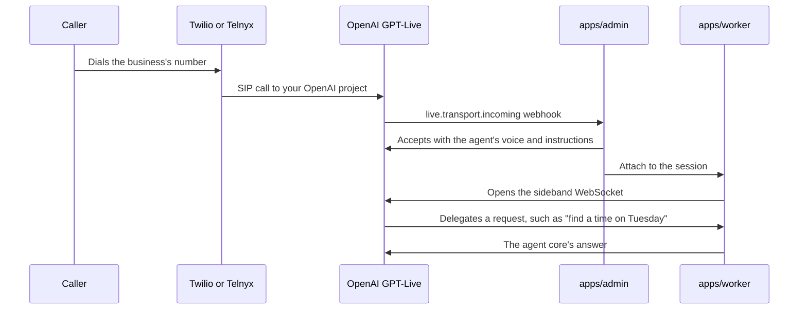

LobbyStack is an MIT-licensed TypeScript monorepo that you can fork, self-host and resell. This page explains which runtime does what, how a call and a chat run through the code, and which package to change for each kind of work. To run LobbyStack first, follow the [self-hosting quickstart](/self-hosting/quickstart).

## Runtimes and packages

Two apps run in production. The packages hold the code they share:

| Path | What it holds |
| --- | --- |
| `apps/admin` | The Next.js dashboard, the partner console, the HTTP API at `/api/v1`, the MCP server at `/api/mcp`, the website widget's API, and the webhooks that start calls |
| `apps/worker` | Queued jobs, the outbox dispatcher, and every live call |
| `packages/agent-core` | The agent that answers calls and chats: its tools, its instructions, and the GPT-Live session and call controller |
| `packages/domain` | Business operations that both apps share, such as booking, messages, knowledge, billing and partners |
| `packages/db` | The Drizzle schema, hand-written SQL migrations, database roles and row-level security |
| `packages/providers` | Adapters for Twilio, Telnyx, calendars, email, storage and embeddings |
| `packages/shared` | Types, locales, billing catalogs and the business snapshot |
| `packages/cli` | The `lobbystack` command, which talks to LobbyStack only through the v1 API |
| `packages/embed` | The loader script that puts the widget on a website |

The [repository's `AGENTS.md`](https://github.com/lobbystack/lobbystack/blob/main/AGENTS.md) lists the commands and the rules each package follows.

## Where data lives

PostgreSQL holds every durable record. Each runtime connects as one of four database roles: `lobbystack_app`, `lobbystack_auth`, `lobbystack_worker` or `lobbystack_dispatcher`. Tenant queries run inside `withBusinessTransaction`, which sets the business for row-level security before your query runs, so the policies limit the query to that business's rows.

Redis runs the BullMQ job queues, rate limits and realtime updates. S3-compatible storage holds recordings and uploaded documents, and a local directory stands in for it during development. Side effects that must survive a crash go into a PostgreSQL outbox in the same transaction as the change, and the worker dispatches them.

## One agent for every channel

`createConversationAgent` in `packages/agent-core` builds an AI SDK `ToolLoopAgent` for one conversation. Each channel calls it from its own runtime:

| Channel | Where the agent runs |
| --- | --- |
| Phone and browser calls | `apps/worker/src/liveCalls.ts`, once for each request GPT-Live delegates |
| Website chat | `apps/admin/app/api/widget/chat/route.ts`, which streams the reply to the widget |
| Instagram direct messages | `apps/worker/src/instagramJobs.ts` |
| Text messages | `apps/worker/src/textReplyJobs.ts`, for businesses whose host turned on AI text replies |

`agentCapabilities` in `packages/agent-core/src/capabilities.ts` decides which tools a conversation gets, from the business's settings and the channel. A browser call has no trusted caller number, for example, so it gets no tool that cancels an appointment. The agent's instructions and GPT-Live's instructions both read that one decision, so GPT-Live offers callers only what the agent can do.

The agent starts from a business snapshot: the business's hours, closures, services, employees, rules and common answers, compiled ahead of time and cached. A call reads it once when it starts, instead of querying the database on each turn. [ADR 0004](https://github.com/lobbystack/lobbystack/blob/main/docs/adr/0004-snapshot-based-voice-personalization.md) records that decision.

## How a phone call runs

OpenAI hosts the call audio, so LobbyStack never relays it. The admin starts the call and the worker runs it:

<Steps>
  <Step title="The carrier sends the call to OpenAI">
    A Twilio Elastic SIP trunk or a Telnyx FQDN connection sends the call to your OpenAI project's SIP address.
  </Step>
  <Step title="The admin accepts it">
    OpenAI sends a `live.transport.incoming` webhook to `/api/webhooks/openai/live`. The admin finds the business from the dialled number, records the call, reserves minutes from its plan, and accepts the session with the agent's voice and instructions.
  </Step>
  <Step title="The worker attaches">
    The admin asks the worker to attach. The worker opens a sideband WebSocket to the session and has GPT-Live greet the caller.
  </Step>
  <Step title="GPT-Live delegates what needs business data">
    GPT-Live answers from the snapshot it got at the start, such as the opening hours. It delegates the rest, such as a booking. The worker answers each request with the agent core, whose tools call `packages/domain`.
  </Step>
  <Step title="The worker finishes the call">
    After the call, the worker saves the transcript, the summary and the call's outcome.
  </Step>
</Steps>

A browser call sends its WebRTC offer to `/api/voice/live/session`. The admin creates the GPT-Live session, returns OpenAI's answer to the browser, and asks the worker to attach, as on a phone call. The [voice runtime notes](https://github.com/lobbystack/lobbystack/blob/main/docs/voice/runtime.md) cover transfers, keypad PINs, greetings and calls the agent can't take.

## Models the agent runs on

Voice runs on OpenAI GPT-Live, which terminates the SIP and WebRTC connections. LobbyStack doesn't support other voice models yet. [ADR 0008](https://github.com/lobbystack/lobbystack/blob/main/docs/adr/0008-gpt-live-voice.md) explains the choice.

The agent core runs on any OpenAI-compatible endpoint. Three sets of variables choose its models:

| Variables | What they set | Default |
| --- | --- | --- |
| `AI_CHAT_API_KEY`, `AI_CHAT_BASE_URL`, `AI_CHAT_MODEL`, `AI_CHAT_REASONING_EFFORT` | The model behind every tool call and every website chat | `gpt-6-luna` on high reasoning, through OpenAI's Responses API |
| `AI_DELEGATION_MODEL`, `AI_DELEGATION_REASONING_EFFORT`, `AI_DELEGATION_SERVICE_TIER` | The same agent while a caller waits on a live call | The `AI_CHAT_*` model on low reasoning and the priority tier |
| `AI_EMBEDDING_*` | Knowledge search | `text-embedding-3-large` |

Endpoints other than OpenAI's use chat completions. The [environment variables reference](/self-hosting/environment-variables) describes each variable.

## How partners fit in

A partner resells LobbyStack under its own brand, and each business belongs to the host or to one partner. The admin picks the partner's brand from the hostname of each request. Partners sell packages to their businesses through their own Stripe accounts with Stripe Connect, and the host can sell partners tiers through Polar. The [partner architecture notes](https://github.com/lobbystack/lobbystack/blob/main/docs/architecture/partners.md) define the modules, and [Run white label on your own servers](/self-hosting/white-label) turns each part on.

## Where to change what

Most changes belong in one package. Start from the job you want to do:

| You want to | Change |
| --- | --- |
| Let the agent do something new on calls and chats | Add an agent-core tool backed by a domain function. See [Add a capability to the agent](/build/add-a-capability). |
| Store new data | Add a migration in `packages/db/migrations`, list it in `SCHEMA_MIGRATIONS`, and give the table row-level security |
| Support another carrier, calendar or email provider | Add an adapter in `packages/providers` |
| Let API clients use a capability | Add an operation in `packages/shared/src/publicApi/operations.ts` and its route in `apps/admin/app/api/v1`, then run `pnpm api:openapi` |
| Let AI assistants use a capability | Add an MCP tool in `apps/admin/src/lib/mcp/tools.ts` |
| Change dashboard copy | Edit the locale files in `apps/admin/public/locales`, in all four languages |
