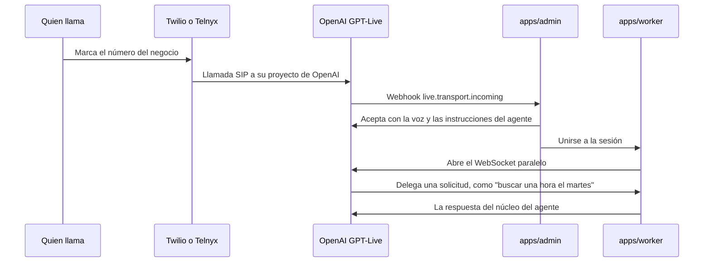

LobbyStack es un monorrepositorio de TypeScript con licencia MIT que usted puede bifurcar, autoalojar y revender. Esta página explica qué hace cada entorno de ejecución, cómo pasan por el código una llamada y un chat, y qué paquete cambiar para cada tipo de trabajo. Para ejecutar LobbyStack primero, siga el [inicio rápido del autoalojamiento](/es/self-hosting/quickstart).

## Entornos de ejecución y paquetes

Dos aplicaciones se ejecutan en producción. Los paquetes guardan el código que comparten:

| Ruta | Qué contiene |
| --- | --- |
| `apps/admin` | El panel de Next.js, la consola de socios, la API HTTP en `/api/v1`, el servidor MCP en `/api/mcp`, la API del widget y los webhooks que inician las llamadas |
| `apps/worker` | Los trabajos en cola, el despachador de la bandeja de salida y cada llamada en vivo |
| `packages/agent-core` | El agente que responde llamadas y chats: sus herramientas, sus instrucciones, la sesión de GPT-Live y el controlador de llamadas |
| `packages/domain` | Las operaciones de negocio que comparten ambas aplicaciones, como las citas, los mensajes, el conocimiento, la facturación y los socios |
| `packages/db` | El esquema de Drizzle, las migraciones SQL escritas a mano, los roles de la base de datos y la seguridad a nivel de fila |
| `packages/providers` | Los adaptadores para Twilio, Telnyx, calendarios, correo, almacenamiento y embeddings |
| `packages/shared` | Los tipos, los idiomas, los catálogos de facturación y la instantánea del negocio |
| `packages/cli` | El comando `lobbystack`, que solo habla con LobbyStack a través de la API v1 |
| `packages/embed` | El script de carga que agrega el widget a un sitio web |

El archivo [`AGENTS.md` del repositorio](https://github.com/lobbystack/lobbystack/blob/main/AGENTS.md) enumera los comandos y las reglas que sigue cada paquete.

## Dónde viven los datos

PostgreSQL guarda cada dato duradero. Cada entorno de ejecución se conecta con uno de cuatro roles de base de datos: `lobbystack_app`, `lobbystack_auth`, `lobbystack_worker` o `lobbystack_dispatcher`. Las consultas de un negocio se ejecutan dentro de `withBusinessTransaction`, que fija el negocio para la seguridad a nivel de fila antes de su consulta. Así, las políticas limitan la consulta a las filas de ese negocio.

Redis maneja las colas de BullMQ, los límites de frecuencia y las actualizaciones en tiempo real. Un almacenamiento compatible con S3 guarda las grabaciones y los documentos subidos, y un directorio local lo reemplaza en desarrollo. Los efectos que deben sobrevivir a una caída van a una bandeja de salida de PostgreSQL, en la misma transacción que el cambio, y el worker los despacha.

## Un solo agente para cada canal

`createConversationAgent` en `packages/agent-core` construye un `ToolLoopAgent` del AI SDK para una conversación. Cada canal lo llama desde su propio entorno de ejecución:

| Canal | Dónde se ejecuta el agente |
| --- | --- |
| Llamadas telefónicas y llamadas en el navegador | `apps/worker/src/liveCalls.ts`, una vez por cada solicitud que GPT-Live delega |
| Chat del sitio web | `apps/admin/app/api/widget/chat/route.ts`, que transmite la respuesta al widget |
| Mensajes directos de Instagram | `apps/worker/src/instagramJobs.ts` |
| Mensajes de texto | `apps/worker/src/textReplyJobs.ts`, para los negocios cuyo anfitrión activó las respuestas con IA a los mensajes de texto |

`agentCapabilities` en `packages/agent-core/src/capabilities.ts` decide qué herramientas recibe una conversación, según la configuración del negocio y el canal. Una llamada en el navegador no tiene un número de quien llama confiable, por ejemplo, así que no recibe ninguna herramienta que cancele una cita. Las instrucciones del agente y las de GPT-Live leen esa misma decisión, así que GPT-Live solo ofrece a quien llama lo que el agente puede hacer.

El agente parte de una instantánea del negocio: su horario, sus cierres, sus servicios, sus empleados, sus reglas y sus respuestas frecuentes, compilados de antemano y guardados en caché. Una llamada la lee una vez al empezar, en lugar de consultar la base de datos en cada turno. El [ADR 0004](https://github.com/lobbystack/lobbystack/blob/main/docs/adr/0004-snapshot-based-voice-personalization.md) registra esa decisión.

## Cómo transcurre una llamada telefónica

OpenAI aloja el audio de la llamada, así que LobbyStack nunca lo retransmite. El admin inicia la llamada y el worker la gestiona:

<Steps>
  <Step title="El proveedor envía la llamada a OpenAI">
    Un trunk Twilio Elastic SIP o una conexión FQDN de Telnyx envía la llamada a la dirección SIP de su proyecto de OpenAI.
  </Step>
  <Step title="El admin la acepta">
    OpenAI envía un webhook `live.transport.incoming` a `/api/webhooks/openai/live`. El admin encuentra el negocio a partir del número marcado, registra la llamada, reserva minutos de su plan y acepta la sesión con la voz y las instrucciones del agente.
  </Step>
  <Step title="El worker se une a la llamada">
    El admin le pide al worker que se una. El worker abre un WebSocket paralelo hacia la sesión y hace que GPT-Live salude a quien llama.
  </Step>
  <Step title="GPT-Live delega lo que necesita datos del negocio">
    GPT-Live responde a partir de la instantánea que recibió al empezar, como el horario. Delega el resto, como una cita. El worker responde cada solicitud con el núcleo del agente, cuyas herramientas llaman a `packages/domain`.
  </Step>
  <Step title="El worker termina la llamada">
    Después de la llamada, el worker guarda la transcripción, el resumen y el resultado de la llamada.
  </Step>
</Steps>

Una llamada en el navegador envía su oferta WebRTC a `/api/voice/live/session`. El admin crea la sesión de GPT-Live, devuelve la respuesta de OpenAI al navegador y le pide al worker que se una, como en una llamada telefónica. Las [notas sobre la ejecución de voz](https://github.com/lobbystack/lobbystack/blob/main/docs/voice/runtime.md) cubren las transferencias, los PIN por teclado, los saludos y las llamadas que el agente no puede tomar.

## Los modelos del agente

La voz funciona con OpenAI GPT-Live, que termina las conexiones SIP y WebRTC. LobbyStack todavía no admite otros modelos de voz. El [ADR 0008](https://github.com/lobbystack/lobbystack/blob/main/docs/adr/0008-gpt-live-voice.md) explica la elección.

El núcleo del agente funciona con cualquier endpoint compatible con OpenAI que usted fije con las variables `AI_CHAT_*`. En una llamada en vivo, las variables `AI_DELEGATION_*` pueden darle un modelo más rápido o menos razonamiento mientras quien llama espera. La [referencia de variables de entorno](/es/self-hosting/environment-variables) enumera ambos grupos y sus valores predeterminados.

## Dónde encajan los socios

Un socio revende LobbyStack con su propia marca, y cada negocio pertenece al anfitrión o a un socio. El admin elige la marca del socio según el nombre de host de cada solicitud. Los socios venden paquetes a sus negocios a través de su propia cuenta de Stripe con Stripe Connect, y el anfitrión puede venderles niveles a los socios a través de Polar. Las [notas sobre la arquitectura de socios](https://github.com/lobbystack/lobbystack/blob/main/docs/architecture/partners.md) definen los módulos, y [Aloje la marca blanca en sus propios servidores](/es/self-hosting/white-label) activa cada parte.

## Dónde cambiar cada cosa

La mayoría de los cambios tocan un solo paquete. Parta de la tarea que quiere hacer:

| Usted quiere | Cambie |
| --- | --- |
| Que el agente haga algo nuevo en llamadas y chats | Agregue una herramienta al núcleo del agente, respaldada por una función del dominio. Vea [Agregue una capacidad al agente](/es/build/add-a-capability). |
| Guardar datos nuevos | Agregue una migración en `packages/db/migrations`, inclúyala en `SCHEMA_MIGRATIONS` y dé a la tabla seguridad a nivel de fila |
| Admitir otro proveedor de telefonía, calendario o correo | Agregue un adaptador en `packages/providers` |
| Que los clientes de la API usen una capacidad | Agregue una operación en `packages/shared/src/publicApi/operations.ts` y su ruta en `apps/admin/app/api/v1`, y luego ejecute `pnpm api:openapi` |
| Que los asistentes de IA usen una capacidad | Agregue una herramienta MCP en `apps/admin/src/lib/mcp/tools.ts` |
| Cambiar los textos del panel | Edite los archivos de idioma en `apps/admin/public/locales`, en los cuatro idiomas |
