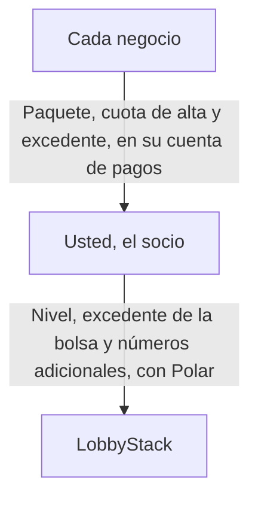

La marca blanca le permite vender la recepcionista con IA de LobbyStack a los negocios que atiende, con el nombre de su empresa. Sus clientes inician sesión en su dirección, ven su logotipo, reciben correos de usted y le pagan directamente. Usted configura y da soporte a cada cliente desde la consola de socios, y le paga a LobbyStack un nivel mensual por los minutos y chats que comparten sus clientes.

Estas páginas usan cuatro términos para las partes implicadas:

- **Socio**: su empresa, la que revende
- **Negocio**: cada cliente que usted configura, con su propia recepcionista, su número de teléfono y su equipo
- **Propietario**: la persona del negocio que inicia sesión y gestiona su recepcionista
- **Anfitrión**: la empresa que opera el despliegue, que es LobbyStack en `app.lobbystack.com`

<Note>
  En un despliegue autoalojado, el anfitrión es la empresa que lo opera. Su dominio, sus precios y su configuración deciden cuáles de las funciones siguientes obtiene usted.
</Note>

## Lo que ven sus clientes con su marca

Cada negocio que usted configura ve su marca, desde su primer correo hasta sus facturas:

- la dirección de su panel: un subdominio como `acme.receptionistportal.com` y, en un nivel de pago, un subdominio de su propio sitio web, como `app.acmeagency.com`
- su nombre, logotipo, favicon y color de marca en las páginas de inicio de sesión, en el panel y en la pestaña del navegador
- correos con su nombre, cuyas respuestas llegan a su correo de soporte
- sus enlaces de términos, privacidad y soporte debajo del formulario de inicio de sesión y en el menú de la cuenta del panel
- una página de pago, facturas y recibos a nombre de su empresa
- el widget de chat del sitio web, cargado desde su dirección

La recepcionista atiende a quienes llaman y a los visitantes del sitio web en nombre del negocio.

## Lo que gestiona desde la consola de socios

En la consola de socios, usted y su equipo gestionan todos sus negocios. Ábrala en `https://app.lobbystack.com/partner`, o en `/partner` en su propia dirección. Cada página cubre una tarea, y su [rol](/es/white-label/team) decide lo que puede hacer en ella:

| Página | Para qué sirve | Quién puede usarla |
| --- | --- | --- |
| **Negocios** | Crear negocios, invitar a sus propietarios, abrir uno para trabajar dentro, fijar su facturación, cederlo o eliminarlo | Todos abren negocios. Los propietarios y administradores los crean, cambian, ceden y eliminan. |
| **Plantillas** | Guardar la configuración de un negocio y crear negocios nuevos a partir de ella | Todos ven las plantillas. Los propietarios y administradores las guardan y eliminan. |
| **Demos** | Crear una recepcionista para un cliente potencial antes de que compre | Todos. Los propietarios y administradores también eligen el acceso de una demo y eliminan demos. |
| **Paquetes** | Definir lo que le paga cada negocio | Propietarios y administradores |
| **Marca y dominio** | Definir su nombre, logotipo, color y enlaces, y conectar su propio dominio | Todos la ven. Los propietarios y administradores la cambian. |
| **Equipo** | Invitar a personas y elegir sus roles | Todos la ven. Los propietarios y administradores invitan y quitan personas. |
| **Claves de API** | Crear claves de plataforma para la API y el comando `lobbystack` | Propietarios y administradores |
| **Pagos** | Conectar la cuenta en la que le pagan sus negocios | Propietarios |
| **Facturación** | Elegir su nivel, seguir su bolsa y configurar su excedente | Propietarios |
| **Configuración** | Activar o desactivar la telemetría de la consola | Todos la ven. Los propietarios y administradores la cambian. |

La página **Facturación** aparece cuando el anfitrión vende niveles o fija su bolsa.

_La página Negocios muestra cada negocio con su propietario, su acceso, su facturación y su uso de este mes._

## Cómo funciona la facturación entre sus clientes, usted y LobbyStack

Sus negocios le pagan a usted, y usted le paga a LobbyStack, en dos facturas separadas:

Usted fija sus propios precios. Un [paquete](/es/white-label/packages) es un precio mensual, una cuota de alta opcional y los minutos y chats que incluye cada mes. Cada negocio paga su paquete en una página de pago a nombre de su empresa, y el dinero llega a su cuenta de pagos. LobbyStack no se queda con ninguna parte de esos pagos. También puede facturar usted mismo a un negocio, fuera de LobbyStack.

Usted le paga a LobbyStack un [nivel](/es/white-label/tiers). Cada nivel tiene un precio mensual y una bolsa de minutos y chats que comparten todos sus negocios. Pasada la bolsa, sus negocios siguen respondiendo y usted paga las tarifas de excedente de su nivel, hasta un límite mensual que usted elige. Gratis no cuesta nada y no necesita tarjeta.

Una llamada o un chat se descuenta del paquete del negocio, si tiene uno, y de su bolsa. En cuanto un negocio llega a cualquiera de los dos límites, sus llamadas se desvían a su número de transferencia o al teléfono de su propietario.

## Dónde sigue apareciendo el nombre de LobbyStack

Algunos lugares nombran a LobbyStack, porque funcionan con las cuentas de LobbyStack:

- **Inicio de sesión**: sus direcciones ofrecen correo y contraseña, sin **Continuar con Google**, porque la pantalla de Google nombraría la aplicación de LobbyStack.
- **Google Calendar e Instagram**: sus pantallas de consentimiento nombran a LobbyStack cuando un negocio los conecta, y luego devuelven a la persona a su dirección.
- **Mensajes de texto**: los SMS salen del número verificado de LobbyStack. El primer SMS de cita que recibe un cliente y la respuesta a HELP nombran a LobbyStack y al negocio. El SMS con el código que verifica el teléfono de una persona nombra a LobbyStack. Los demás SMS nombran solo al negocio.
- **La consola en el dominio de LobbyStack**: `app.lobbystack.com/partner` muestra la marca de LobbyStack. En su dirección, la consola muestra la suya.

LobbyStack no contacta a sus negocios y nunca les envía sus correos de marketing, de configuración inicial ni del fundador.

## Empiece a revender

La configuración lleva cinco pasos, y puede facturar usted mismo a su primer negocio antes de conectar los pagos:

<Steps>
  <Step title="Regístrese como socio">
    Cree su cuenta de socio y elija la dirección de su panel. Consulte [Regístrese como socio](/es/white-label/sign-up).
  </Step>
  <Step title="Agregue su marca">
    Suba su logotipo y defina su nombre, color y enlaces. Consulte [Ponga su marca en su panel y conecte su dominio](/es/white-label/branding).
  </Step>
  <Step title="Conecte los pagos y cree un paquete">
    Conecte su cuenta de pagos y defina lo que le pagan los negocios. Consulte [Facture a sus negocios con paquetes](/es/white-label/packages).
  </Step>
  <Step title="Cree un negocio">
    Cree su primer negocio e invite a su propietario. Consulte [Cree y gestione los negocios de sus clientes](/es/white-label/businesses).
  </Step>
  <Step title="Elija un nivel">
    Quédese en Gratis mientras lo prueba, y luego elija un nivel de pago para tener más minutos, más números de teléfono y su propio dominio. Consulte [Elija un nivel y gestione lo que paga a LobbyStack](/es/white-label/tiers).
  </Step>
</Steps>
