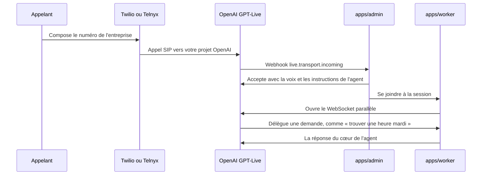

LobbyStack est un monodépôt TypeScript sous licence MIT que vous pouvez dupliquer, auto-héberger et revendre. Cette page explique ce que fait chaque environnement d'exécution, comment un appel et un clavardage traversent le code, et quel paquet modifier pour chaque type de travail. Pour faire tourner LobbyStack d'abord, suivez le [démarrage rapide de l'auto-hébergement](/fr/self-hosting/quickstart).

## Environnements d'exécution et paquets

Deux applications tournent en production. Les paquets contiennent le code qu'elles partagent :

| Chemin | Ce qu'il contient |
| --- | --- |
| `apps/admin` | Le tableau de bord Next.js, la console partenaire, l'API HTTP à `/api/v1`, le serveur MCP à `/api/mcp`, l'API du widget et les webhooks qui démarrent les appels |
| `apps/worker` | Les tâches en file d'attente, le répartiteur de la boîte d'envoi et chaque appel en direct |
| `packages/agent-core` | L'agent qui répond aux appels et aux clavardages : ses outils, ses instructions, la session GPT-Live et le contrôleur d'appel |
| `packages/domain` | Les opérations d'affaires que partagent les deux applications, comme la prise de rendez-vous, les messages, les connaissances, la facturation et les partenaires |
| `packages/db` | Le schéma Drizzle, les migrations SQL écrites à la main, les rôles de base de données et la sécurité au niveau des lignes |
| `packages/providers` | Les adaptateurs pour Twilio, Telnyx, les agendas, le courriel, le stockage et les plongements |
| `packages/shared` | Les types, les langues, les catalogues de facturation et l'instantané de l'entreprise |
| `packages/cli` | La commande `lobbystack`, qui ne parle à LobbyStack que par l'API v1 |
| `packages/embed` | Le script de chargement qui ajoute le widget à un site Web |

Le fichier [`AGENTS.md` du dépôt](https://github.com/lobbystack/lobbystack/blob/main/AGENTS.md) liste les commandes et les règles que suit chaque paquet.

## Où vivent les données

PostgreSQL conserve chaque donnée durable. Chaque environnement d'exécution se connecte avec l'un de quatre rôles de base de données : `lobbystack_app`, `lobbystack_auth`, `lobbystack_worker` ou `lobbystack_dispatcher`. Les requêtes d'une entreprise s'exécutent dans `withBusinessTransaction`, qui fixe l'entreprise pour la sécurité au niveau des lignes avant votre requête. Les politiques limitent ainsi la requête aux lignes de cette entreprise.

Redis gère les files d'attente BullMQ, les limites de débit et les mises à jour en temps réel. Un stockage compatible S3 conserve les enregistrements et les documents téléversés, et un répertoire local le remplace en développement. Les effets qui doivent survivre à une panne vont dans une boîte d'envoi PostgreSQL, dans la même transaction que la modification, et le worker les répartit.

## Un seul agent pour chaque canal

`createConversationAgent` dans `packages/agent-core` construit un `ToolLoopAgent` du AI SDK pour une conversation. Chaque canal l'appelle depuis son propre environnement d'exécution :

| Canal | Où l'agent s'exécute |
| --- | --- |
| Appels téléphoniques et appels dans le navigateur | `apps/worker/src/liveCalls.ts`, une fois pour chaque demande que GPT-Live délègue |
| Clavardage sur le site Web | `apps/admin/app/api/widget/chat/route.ts`, qui diffuse la réponse au widget |
| Messages directs Instagram | `apps/worker/src/instagramJobs.ts` |
| Textos | `apps/worker/src/textReplyJobs.ts`, pour les entreprises dont l'hôte a activé les réponses IA aux textos |

`agentCapabilities` dans `packages/agent-core/src/capabilities.ts` décide quels outils reçoit une conversation, selon les réglages de l'entreprise et le canal. Un appel dans le navigateur n'a pas de numéro d'appelant fiable, par exemple, alors il ne reçoit aucun outil qui annule un rendez-vous. Les instructions de l'agent et celles de GPT-Live lisent toutes deux cette décision, alors GPT-Live n'offre aux appelants que ce que l'agent peut faire.

L'agent part d'un instantané de l'entreprise : ses heures, ses fermetures, ses services, ses employés, ses règles et ses réponses courantes, compilés d'avance et mis en cache. Un appel le lit une fois au début, au lieu d'interroger la base de données à chaque tour. L'[ADR 0004](https://github.com/lobbystack/lobbystack/blob/main/docs/adr/0004-snapshot-based-voice-personalization.md) consigne cette décision.

## Comment se déroule un appel téléphonique

OpenAI héberge l'audio de l'appel, alors LobbyStack ne le relaie jamais. L'admin démarre l'appel et le worker le gère :

<Steps>
  <Step title="Le fournisseur envoie l'appel à OpenAI">
    Un trunk Twilio Elastic SIP ou une connexion FQDN Telnyx envoie l'appel à l'adresse SIP de votre projet OpenAI.
  </Step>
  <Step title="L'admin l'accepte">
    OpenAI envoie un webhook `live.transport.incoming` à `/api/webhooks/openai/live`. L'admin trouve l'entreprise à partir du numéro composé, enregistre l'appel, réserve des minutes de son forfait et accepte la session avec la voix et les instructions de l'agent.
  </Step>
  <Step title="Le worker se joint à l'appel">
    L'admin demande au worker de se joindre. Le worker ouvre un WebSocket parallèle vers la session et fait saluer l'appelant par GPT-Live.
  </Step>
  <Step title="GPT-Live délègue ce qui demande des données de l'entreprise">
    GPT-Live répond à partir de l'instantané reçu au début, comme les heures d'ouverture. Il délègue le reste, comme une prise de rendez-vous. Le worker répond à chaque demande avec le cœur de l'agent, dont les outils appellent `packages/domain`.
  </Step>
  <Step title="Le worker termine l'appel">
    Après l'appel, le worker enregistre la transcription, le résumé et le résultat de l'appel.
  </Step>
</Steps>

Un appel dans le navigateur envoie son offre WebRTC à `/api/voice/live/session`. L'admin crée la session GPT-Live, renvoie la réponse d'OpenAI au navigateur et demande au worker de se joindre, comme pour un appel téléphonique. Les [notes sur l'exécution vocale](https://github.com/lobbystack/lobbystack/blob/main/docs/voice/runtime.md) couvrent les transferts, les NIP au clavier, les salutations et les appels que l'agent ne peut pas prendre.

## Les modèles de l'agent

La voix passe par OpenAI GPT-Live, qui termine les connexions SIP et WebRTC. LobbyStack ne prend pas encore en charge d'autres modèles vocaux. L'[ADR 0008](https://github.com/lobbystack/lobbystack/blob/main/docs/adr/0008-gpt-live-voice.md) explique ce choix.

Le cœur de l'agent tourne sur n'importe quel point de terminaison compatible OpenAI que vous fixez avec les variables `AI_CHAT_*`. Pendant un appel en direct, les variables `AI_DELEGATION_*` peuvent lui donner un modèle plus rapide ou un raisonnement plus faible pendant que l'appelant attend. La [référence des variables d'environnement](/fr/self-hosting/environment-variables) liste les deux ensembles et leurs valeurs par défaut.

## La place des partenaires

Un partenaire revend LobbyStack sous sa propre marque, et chaque entreprise appartient à l'hôte ou à un partenaire. L'admin choisit la marque du partenaire selon le nom d'hôte de chaque requête. Les partenaires vendent des forfaits à leurs entreprises par leur propre compte Stripe avec Stripe Connect, et l'hôte peut vendre des paliers aux partenaires par Polar. Les [notes sur l'architecture des partenaires](https://github.com/lobbystack/lobbystack/blob/main/docs/architecture/partners.md) définissent les modules, et [Héberger la marque blanche sur vos propres serveurs](/fr/self-hosting/white-label) active chaque partie.

## Où modifier quoi

La plupart des changements touchent un seul paquet. Partez de la tâche à faire :

| Vous voulez | Modifiez |
| --- | --- |
| Permettre à l'agent de faire quelque chose de nouveau en appel et en clavardage | Ajoutez un outil au cœur de l'agent, appuyé sur une fonction du domaine. Voyez [Ajouter une capacité à l'agent](/fr/build/add-a-capability). |
| Conserver de nouvelles données | Ajoutez une migration dans `packages/db/migrations`, listez-la dans `SCHEMA_MIGRATIONS` et donnez à la table la sécurité au niveau des lignes |
| Prendre en charge un autre fournisseur de téléphonie, d'agenda ou de courriel | Ajoutez un adaptateur dans `packages/providers` |
| Rendre une capacité accessible aux clients de l'API | Ajoutez une opération dans `packages/shared/src/publicApi/operations.ts` et sa route dans `apps/admin/app/api/v1`, puis lancez `pnpm api:openapi` |
| Rendre une capacité accessible aux assistants IA | Ajoutez un outil MCP dans `apps/admin/src/lib/mcp/tools.ts` |
| Modifier les textes du tableau de bord | Modifiez les fichiers de langue dans `apps/admin/public/locales`, dans les quatre langues |
