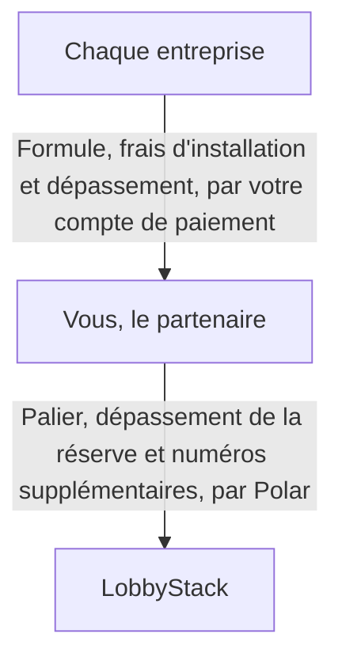

La marque blanche vous permet de vendre la réceptionniste IA de LobbyStack aux entreprises que vous servez, sous le nom de votre société. Vos clients se connectent à votre adresse, voient votre logo, reçoivent vos courriels et vous paient directement. Vous configurez et accompagnez chaque client depuis la console partenaire, et vous payez à LobbyStack un palier mensuel pour les minutes et les clavardages que vos clients partagent.

Ces pages désignent les parties en jeu par quatre termes :

- **Partenaire** : votre société, celle qui revend
- **Entreprise** : chaque client que vous configurez, avec sa propre réceptionniste, son numéro de téléphone et son équipe
- **Propriétaire** : la personne de l'entreprise qui se connecte et gère sa réceptionniste
- **Hôte** : la société qui exploite le déploiement, soit LobbyStack sur `app.lobbystack.com`

<Note>
  Sur un déploiement auto-hébergé, la société qui l'exploite est l'hôte. Son domaine, ses prix et sa configuration déterminent les fonctionnalités ci-dessous auxquelles vous avez accès.
</Note>

## Ce que vos clients voient sous votre marque

Chaque entreprise que vous configurez voit votre marque, de son premier courriel à ses factures :

- l'adresse de votre tableau de bord : un sous-domaine comme `acme.receptionistportal.com` et, sur un palier payant, un sous-domaine de votre propre site Web, comme `app.acmeagency.com`
- votre nom, votre logo, votre favicon et la couleur de votre marque sur les pages de connexion, le tableau de bord et l'onglet du navigateur
- des courriels à votre nom, dont les réponses arrivent à votre courriel d'assistance
- vos liens vers vos conditions, votre politique de confidentialité et votre assistance, sous le formulaire de connexion et dans le menu du compte du tableau de bord
- une page de paiement, des factures et des reçus au nom de votre société
- le widget de clavardage du site Web, chargé depuis votre adresse

La réceptionniste répond aux appelants et aux visiteurs du site Web au nom de l'entreprise.

## Ce que vous gérez depuis la console partenaire

La console partenaire est l'endroit où votre équipe et vous gérez chaque entreprise. Ouvrez-la à `https://app.lobbystack.com/partner`, ou à `/partner` sur votre propre adresse. Chaque page sert à une tâche, et votre [rôle](/fr/white-label/team) détermine ce que vous pouvez y faire :

| Page | À quoi elle sert | Qui peut l'utiliser |
| --- | --- | --- |
| **Entreprises** | Créer des entreprises, inviter leurs propriétaires, en ouvrir une pour y travailler, choisir sa facturation, la céder ou la supprimer | Tout le monde ouvre les entreprises. Les propriétaires et les administrateurs les créent, les modifient, les cèdent et les suppriment. |
| **Modèles** | Enregistrer la configuration d'une entreprise et créer de nouvelles entreprises à partir de celle-ci | Tout le monde voit les modèles. Les propriétaires et les administrateurs les enregistrent et les suppriment. |
| **Démos** | Créer une réceptionniste pour un prospect avant qu'il achète | Tout le monde. Les propriétaires et les administrateurs choisissent aussi l'accès d'une démo et suppriment les démos. |
| **Formules** | Définir ce que chaque entreprise vous paie | Propriétaires et administrateurs |
| **Image de marque et domaine** | Définir votre nom, votre logo, votre couleur et vos liens, et connecter votre propre domaine | Tout le monde la voit. Les propriétaires et les administrateurs la modifient. |
| **Équipe** | Inviter des personnes et choisir leur rôle | Tout le monde la voit. Les propriétaires et les administrateurs invitent et retirent des personnes. |
| **Clés API** | Créer des clés de plateforme pour l'API et la commande `lobbystack` | Propriétaires et administrateurs |
| **Paiements** | Connecter le compte sur lequel vos entreprises vous paient | Propriétaires |
| **Facturation** | Choisir votre palier, suivre votre réserve et régler son dépassement | Propriétaires |
| **Réglages** | Activer ou désactiver la télémétrie de la console | Tout le monde la voit. Les propriétaires et les administrateurs la modifient. |

La page **Facturation** apparaît dès que l'hôte vend des paliers ou fixe votre réserve.

_La page Entreprises liste chaque entreprise avec son propriétaire, son accès, sa facturation et son utilisation du mois._

## Comment la facturation fonctionne entre vos clients, vous et LobbyStack

Vos entreprises vous paient, et vous payez LobbyStack, sur deux factures distinctes :

Vous fixez vos propres prix. Une [formule](/fr/white-label/packages) comprend un prix mensuel, des frais d'installation facultatifs, et les minutes et les clavardages inclus chaque mois. Chaque entreprise paie sa formule sur une page de paiement au nom de votre société, et l'argent arrive sur votre compte de paiement. LobbyStack ne prend aucune part de ces paiements. Vous pouvez aussi facturer une entreprise vous-même, en dehors de LobbyStack.

Vous payez à LobbyStack un [palier](/fr/white-label/tiers). Chaque palier a un prix mensuel et une réserve de minutes et de clavardages que toutes vos entreprises partagent. Au-delà de la réserve, vos entreprises continuent de répondre et vous payez les tarifs de dépassement de votre palier, jusqu'à un plafond mensuel que vous choisissez. Le palier Gratuit ne coûte rien et ne demande aucune carte.

Un appel ou un clavardage compte dans la formule de l'entreprise, si elle en a une, et dans votre réserve. Dès qu'une entreprise atteint l'une ou l'autre de ces limites, ses appels vont à son numéro de transfert ou au téléphone de son propriétaire.

## Où le nom de LobbyStack apparaît encore

Quelques endroits nomment LobbyStack, parce qu'ils fonctionnent sur les propres comptes de LobbyStack :

- **Connexion** : vos adresses proposent la connexion par courriel et mot de passe, sans **Continuer avec Google**, car l'écran de Google nommerait l'application de LobbyStack.
- **Google Calendar et Instagram** : leurs écrans de consentement nomment LobbyStack quand une entreprise les connecte, puis renvoient la personne vers votre adresse.
- **Textos** : les textos viennent du numéro vérifié de LobbyStack. Le premier texto de rendez-vous d'un client et la réponse à HELP nomment LobbyStack et l'entreprise. Le code qui vérifie le téléphone d'une personne nomme LobbyStack. Les autres textos ne nomment que l'entreprise.
- **La console sur le domaine de LobbyStack** : `app.lobbystack.com/partner` affiche la marque de LobbyStack. Sur votre adresse, la console affiche la vôtre.

LobbyStack ne contacte pas vos entreprises et ne leur envoie jamais ses courriels de marketing, d'intégration ou du fondateur.

## Commencer à revendre

La configuration se fait en cinq étapes, et vous pouvez facturer vous-même votre première entreprise avant de connecter les paiements :

<Steps>
  <Step title="S'inscrire comme partenaire">
    Créez votre compte partenaire et choisissez l'adresse de votre tableau de bord. Consultez [S'inscrire comme partenaire](/fr/white-label/sign-up).
  </Step>
  <Step title="Ajouter votre marque">
    Téléversez votre logo et définissez votre nom, votre couleur et vos liens. Consultez [Personnaliser votre tableau de bord et connecter votre domaine](/fr/white-label/branding).
  </Step>
  <Step title="Connecter les paiements et créer une formule">
    Connectez votre compte de paiement et définissez ce que les entreprises vous paient. Consultez [Facturer vos entreprises avec des formules](/fr/white-label/packages).
  </Step>
  <Step title="Créer une entreprise">
    Créez votre première entreprise et invitez son propriétaire. Consultez [Créer et gérer les entreprises de vos clients](/fr/white-label/businesses).
  </Step>
  <Step title="Choisir un palier">
    Restez sur Gratuit pendant votre essai, puis choisissez un palier payant pour obtenir plus de minutes et de numéros de téléphone, et votre propre domaine. Consultez [Choisir un palier et gérer ce que vous payez à LobbyStack](/fr/white-label/tiers).
  </Step>
</Steps>
