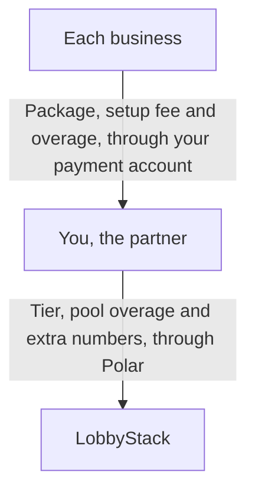

White label lets you sell LobbyStack's AI receptionist to the businesses you serve, under your company's name. Your clients sign in at your address, see your logo, get emails from you and pay you directly. You set up and support each client from the partner console, and you pay LobbyStack one monthly tier for the minutes and chats your clients share.

These pages use four words for the people involved:

- **Partner**: your company, the one that resells
- **Business**: each client you set up, with its own receptionist, phone number and team
- **Owner**: the person at a business who signs in and runs its receptionist
- **Host**: the company that runs the deployment, which is LobbyStack on `app.lobbystack.com`

<Note>
  On a self-hosted deployment, the company that runs it is the host. Its domain, its prices and its configuration decide which of the features below you get.
</Note>

## What your clients see under your brand

Each business you set up sees your brand, from its first email to its invoices:

- your dashboard address: a subdomain such as `acme.receptionistportal.com`, and on a paid tier a subdomain of your own website, such as `app.acmeagency.com`
- your name, logo, favicon and brand color on the sign-in pages, the dashboard and the browser tab
- emails under your name, with replies going to your support email
- your terms, privacy and support links below the sign-in form and in the dashboard's account menu
- a checkout, invoices and receipts in your company's name
- the website chat widget, loaded from your address

The receptionist answers callers and website visitors in the business's name.

## What you run from the partner console

The partner console is where you and your team run every business. Open it at `https://app.lobbystack.com/partner`, or at `/partner` on your own address. Each page covers one job, and your [role](/white-label/team) decides what you can do there:

| Page | What it's for | Who can use it |
| --- | --- | --- |
| **Businesses** | Create businesses, invite their owners, open one to work inside it, set its billing, release or delete it | Everyone opens businesses. Owners and admins create, change, release and delete them. |
| **Templates** | Save a business's setup and start new businesses from it | Everyone sees templates. Owners and admins save and delete them. |
| **Demos** | Build a receptionist for a prospect before they buy | Everyone. Owners and admins also choose a demo's access and delete demos. |
| **Packages** | Define what each business pays you | Owners and admins |
| **Branding & domain** | Set your name, logo, color and links, and connect your own domain | Everyone sees it. Owners and admins change it. |
| **Team** | Invite people and choose their roles | Everyone sees it. Owners and admins invite and remove people. |
| **API keys** | Make platform keys for the API and the `lobbystack` command | Owners and admins |
| **Payments** | Connect the account your businesses pay into | Owners |
| **Billing** | Choose your tier, follow your pool, and set its overage | Owners |
| **Settings** | Turn the console's telemetry on or off | Everyone sees it. Owners and admins change it. |

The **Billing** page shows up once the host sells tiers or sets your pool.

_The Businesses page lists each business with its owner, access, billing and usage this month._

## How billing works between your clients, you and LobbyStack

Your businesses pay you, and you pay LobbyStack, on two separate bills:

You set your own prices. A [package](/white-label/packages) is a monthly price, an optional setup fee and the minutes and chats each month includes. Each business pays for its package at a checkout in your company's name, and the money goes to your payment account. LobbyStack takes no share of those payments. You can also bill a business yourself, outside LobbyStack.

You pay LobbyStack for a [tier](/white-label/tiers). Each tier has a monthly price and a pool of minutes and chats that all your businesses share. Past the pool, your businesses keep answering and you pay your tier's overage rates, up to a monthly cap you choose. Free costs nothing and needs no card.

A call or chat counts against the business's package, when it has one, and against your pool. Once a business reaches either limit, its calls forward to its transfer number or its owner's phone.

## Where LobbyStack's name still appears

A few places name LobbyStack, because they run on LobbyStack's own accounts:

- **Sign-in**: your addresses offer email and password, without **Continue with Google**, since Google's screen would name LobbyStack's app.
- **Google Calendar and Instagram**: their consent screens name LobbyStack when a business connects them, then send the person back to your address.
- **Text messages**: texts come from LobbyStack's verified number. A customer's first appointment text and the reply to HELP name LobbyStack and the business. The code that verifies a person's phone names LobbyStack. Other texts name only the business.
- **The console on LobbyStack's domain**: `app.lobbystack.com/partner` shows LobbyStack's brand. On your address, the console shows yours.

LobbyStack doesn't contact your businesses, and never sends them its marketing, onboarding or founder emails.

## Start reselling

Setting up takes five steps, and you can bill your first business yourself before you connect payments:

<Steps>
  <Step title="Sign up as a partner">
    Create your partner account and pick your dashboard address. See [Sign up as a partner](/white-label/sign-up).
  </Step>
  <Step title="Add your brand">
    Upload your logo and set your name, color and links. See [Brand your dashboard and connect your domain](/white-label/branding).
  </Step>
  <Step title="Connect payments and create a package">
    Connect your payment account and define what businesses pay you. See [Bill your businesses with packages](/white-label/packages).
  </Step>
  <Step title="Create a business">
    Create your first business and invite its owner. See [Create and run your clients' businesses](/white-label/businesses).
  </Step>
  <Step title="Choose a tier">
    Stay on Free while you try it, then pick a paid tier for more minutes, phone numbers and your own domain. See [Choose a tier and manage what you pay LobbyStack](/white-label/tiers).
  </Step>
</Steps>
